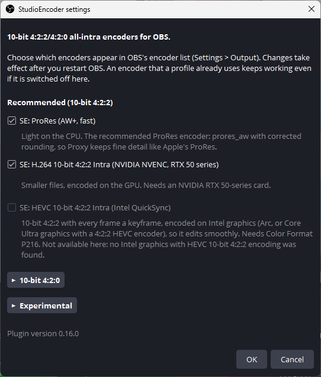
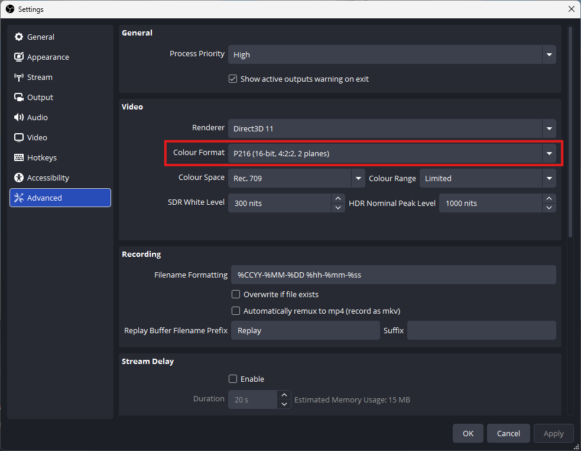
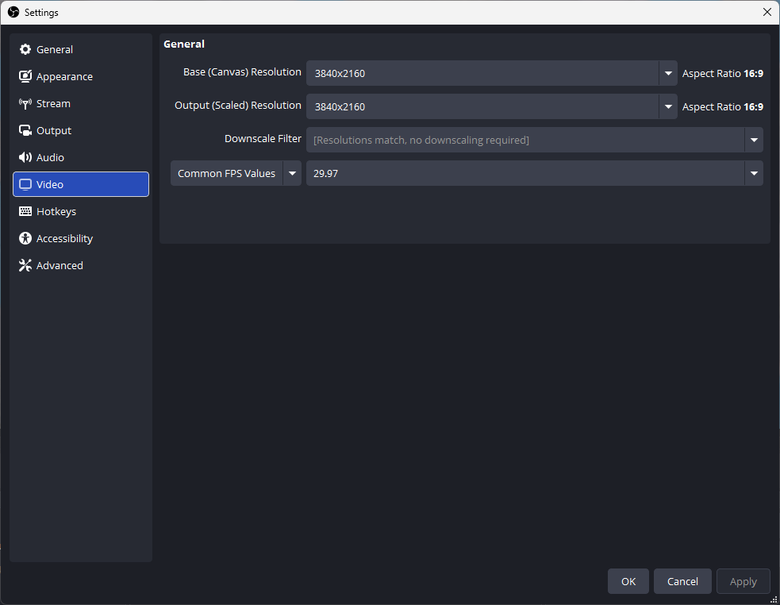
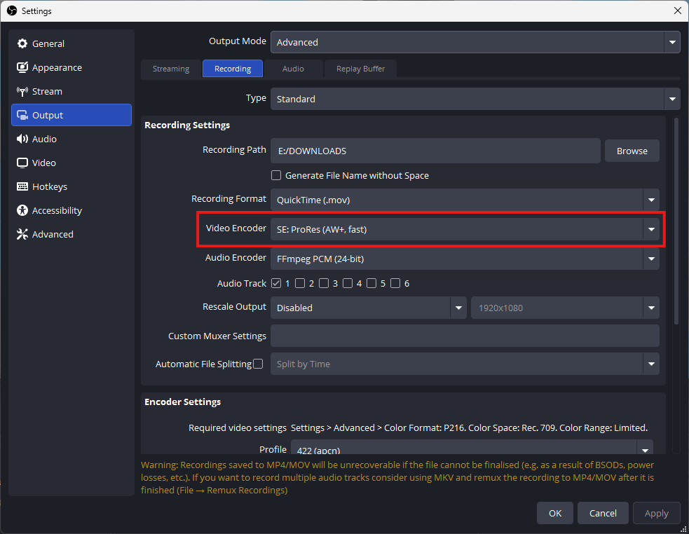

# StudioEncoder: editing-friendly encoders for OBS Studio

An OBS Studio plugin for Windows that adds all-intra, 10-bit encoders to OBS Studio 33 and up, for 4K recording to MOV that edits smoothly.

- **AW+** is a ProRes-compatible CPU encoder with 10-bit 4:2:2 colour. It is an improved version of FFmpeg's ProRes encoder (`prores_aw`) and fixes a rounding bug that made footage blurry in ProRes Proxy mode.
- **GPU encoders with 10-bit 4:2:2:** H.264 for NVIDIA RTX 50 series cards, and HEVC through Intel QuickSync (tested on an Intel Panther Lake CPU).
- **GPU encoders with 10-bit 4:2:0:** all-intra HEVC for AMD GPUs and for NVIDIA cards older than the RTX 50 series. OBS already has hardware HEVC encoders for these GPUs, but StudioEncoder makes them easier to use, with simple presets instead of arcane settings. AMD GPUs cannot encode 4:2:2, so these stay 4:2:0.

As of OBS 33.0, the Custom Output (FFmpeg) pathway has a bug that now and then causes a "non monotonically increasing dts" error and can stop a new recording from working. StudioEncoder avoids this pathway: its encoders run in **Standard** recording mode, so they run smoothly.

> **Not Apple ProRes.** This plugin is unofficial and is not affiliated with or endorsed by Apple. Apple ProRes is a licensed, certified codec. The encoders here are independent implementations of the publicly documented format (SMPTE RDD 36): FFmpeg's `prores_aw` (and the AW+ encoder built from it), the FilmCraft Rust encoder and the OxideAV Rust encoder. Their output plays in common editors, such as DaVinci Resolve, but it is not certified by Apple.

## Encoders

| Encoder in OBS | Implementation | Notes |
|---|---|---|
| SE: ProRes (AW+, fast) | AW+: FFmpeg's `prores_aw` built into the plugin, with corrected rounding | **Recommended.** Light on CPU: on CPUs with AVX2 its encoder share is about half of FFmpeg's own prores_aw, and it falls back to plain C (still faster than FFmpeg) on older or low-end CPUs. Proxy keeps fine detail; FFmpeg's prores_aw makes Proxy blurry. |
| ProRes-compatible (Rust / FilmCraft) (experimental) | [FilmCraft](https://github.com/storytold/filmcraft) Rust encoder | Experimental. Heavy CPU use at 4K. |
| ProRes (OxideAV, pure Rust) (experimental) | [OxideAV](https://github.com/oxideav/oxideav) `oxideav-prores` | Experimental. About 2.5 times the CPU of prores_aw at 4K (30% against 12% of a 22-thread laptop) and about a third bigger files at profile 422 on live camera footage, with no quality advantage per bit. Very young code (0.1). |
| H.264 10-bit 4:2:2 Intra (NVIDIA NVENC, RTX 50 series) | FFmpeg `h264_nvenc` | Smaller files on the GPU. Needs an **RTX 50-series** card. See below. |
| HEVC 10-bit 4:2:0 Intra (NVIDIA NVENC) | FFmpeg `hevc_nvenc` | For NVIDIA cards **older than the RTX 50 series** (no H.264 10-bit there): 10-bit **4:2:0**, every frame a keyframe, a bitrate setting. See below. |
| HEVC 10-bit Intra (AMD) | FFmpeg `hevc_amf` | 10-bit **4:2:0**, every frame a keyframe, on a Radeon GPU, with four quality presets. See below. |

Profiles: Proxy (`apco`), LT (`apcs`), 422 (`apcn`), HQ (`apch`).

### Choosing which encoders show up (Tools > StudioEncoder)

OBS's encoder list stays short by default. **Tools > StudioEncoder** opens a window listing every encoder in this plugin in three sections: **Recommended (10-bit 4:2:2)** (AW+ and the RTX 50 H.264 encoder), **10-bit 4:2:0** (the NVIDIA and AMD HEVC encoders) and **Experimental** (FilmCraft and OxideAV, off by default). The last two are collapsible groups that start closed; click the small arrow to open one. Tick the ones you want and press OK; the change takes effect after you restart OBS.

 StudioEncoder) in OBS: a list of encoders with checkboxes and collapsible 10-bit 4:2:0 and Experimental groups" width="420">

An encoder that is switched off is only hidden from the dropdown. A profile that already uses it keeps working. All encoders from this plugin start with "SE:" in OBS's encoder list so they are easy to spot.

### Why AW+ (fixed prores_aw)

FFmpeg's prores_aw divides each detail coefficient by its quantiser step and **truncates toward zero**, so anything smaller than a full step is thrown away. At Proxy, where steps are coarse, that removes fine texture: faces and fabric look smeared. Apple's encoder uses the same Proxy matrix and quantiser but keeps that detail. AW+ is prores_aw ported into the plugin with rounding instead of truncation (offset per profile: Proxy 4/8, LT 3/8, 422 3/8, HQ 2/8 of a step, chosen for the best quality per bit).

Measured on a 4K camera clip (PSNR, higher is better):

| Profile | FFmpeg prores_aw | AW+ | Apple ProRes |
|---|---|---|---|
| Proxy | 74 Mbit/s, 54.0 dB | **94 Mbit/s, 56.2 dB** | 96 Mbit/s, 56.5 dB |
| LT | 170 Mbit/s, 59.7 dB | 198 Mbit/s, 61.6 dB | 235 Mbit/s, 62.2 dB |
| HQ | 492 Mbit/s, 71.1 dB | 560 Mbit/s, 73.5 dB | 520 Mbit/s, 72.2 dB |

With rounding switched off, AW+ produces byte-identical files to FFmpeg's prores_aw (checked on all four profiles).
The GPU encoders check your graphics card when OBS starts. If the card cannot run one (an NVIDIA card older than an RTX 50 series for the H.264 encoder, no NVIDIA card with 10-bit HEVC for the NVIDIA HEVC encoder, no Radeon for the AMD one), that encoder is hidden from the list and shown grayed out in this window.

### H.264 10-bit 4:2:2 Intra (NVIDIA NVENC)

A space-saving alternative to ProRes, encoded on the GPU. Every frame is a keyframe (all-intra), High 4:2:2 profile, 10-bit, constant bitrate, so it edits like ProRes but is smaller at a small cost in quality.

- **Needs an NVIDIA RTX 50-series GPU** (Blackwell) and a current driver. Older NVIDIA cards can't encode H.264 10-bit or 4:2:2; on those the recording won't start and OBS shows an error. Use ProRes (prores_aw) there.
- **Bitrate**: 100 Mbit/s (small, about ProRes LT quality), **200 (default**, better than ProRes LT, about half the size of ProRes 422), 300 (high). Above 400 adds nothing.
- **Speed**: Quality (p5, default) or Fast (p1, slightly lower quality).
- Frames go to the GPU as P216 without conversion. At most 2 frames are in flight, because consumer NVIDIA cards limit the number of encoder sessions.
- In an FFmpeg test on an RTX 5080 (4K 29.97 camera footage) this ran at about 77 fps at p5 and 101 fps at p1.

### HEVC 10-bit 4:2:0 Intra (NVIDIA NVENC)

For NVIDIA cards **older than the RTX 50 series** (GTX 10 series and newer should work; tested on an RTX 4070 Laptop). Those cards have no H.264 10-bit mode and no 4:2:2, so this is **10-bit 4:2:0** HEVC (Main 10): the colour detail is half of what ProRes 422 keeps, but every frame is a keyframe, so it cuts and scrubs like ProRes, in smaller files. On an RTX 50 card you also get the H.264 4:2:2 encoder above, which keeps the colour detail.

- **Settings > Advanced > Color Format: P010** (not P216), Rec. 709, Limited. The picture goes to the GPU as OBS produces it, with no conversion.
- **Bitrate** (30 to 400 Mbit/s, default 150) and **Speed** (Quality p5, or Fast p1). In a test on one 4K camera clip (luma quality against the source): 100 Mbit/s measured 57.6 dB, better than ProRes Proxy (53.7 dB at 95); 150 measured 59.4 dB, about the same as AW+ LT (59.6 dB at 200) with 70% of its bits; 200 measured 60.8 dB. The Fast preset is only slightly lower in quality and about as fast on that GPU.
- Recordings are HEVC Main 10 in MOV with the `hvc1` tag (all frames keyframes, decode without errors in FFmpeg). Not yet tried in Resolve or Premiere.
- At most 2 frames are encoded at once, because consumer NVIDIA cards limit the number of encoder sessions. About 15 ms per 4K frame on the RTX 4070 Laptop; OBS used about 7% of the CPU (about 5% of that is the scene itself).

### HEVC 10-bit 4:2:0 Intra (AMD)

For Radeon users. AMD's video encoder cannot do 4:2:2 at all (and its H.264 encoder cannot do 10-bit), so this is **10-bit 4:2:0**: the colour detail is half of what ProRes 422 keeps. Every frame is a keyframe, so every frame can be cut and scrubbed without decoding neighbours, as with ProRes, in much smaller files (High is about a third of ProRes 422 on the test clip). OBS's own "AMD HW H.265 (HEVC)" can also record 10-bit, but it needs a normal GOP and bitrate tuning; this encoder replaces that with one **Quality** choice.

- **Settings > Advanced > Color Format: P010** (not P216), Rec. 709, Limited.
- **Quality** is constant, so the file size depends on the picture. Typical sizes for 4K 29.97 camera footage:

| Preset | Size | Luma PSNR on a 4K camera clip |
|---|---|---|
| Small | about 30 Mbit/s | 52.4 dB |
| Standard | about 70 Mbit/s | 55.3 dB (ProRes LT: 56.2 dB at 169 Mbit/s) |
| **High** (default) | about 120 Mbit/s | 56.7 dB |
| Maximum | about 170 Mbit/s | 57.8 dB (the encoder's ceiling) |

  The PSNR figures compare against the camera clip converted to 4:2:0, so they are fair to this encoder; ProRes keeps 4:2:2 colour that this one cannot. Noisy footage makes bigger files at the same preset.
- Measured on a Radeon RX 9070 XT: about 3.8 ms per 4K frame, no repeated frames at 4K 29.97. The AMD encoder returns each packet one frame late, so the last frame before you press Stop is dropped.
- Recordings are HEVC Main 10 in MOV (all frames keyframes, steady timestamps, decode without errors in FFmpeg). Not yet tried in Resolve or Premiere.

## 10-bit 4:2:2 capture (P210), Windows

OBS's own Video Capture Device source can't bring in 10-bit 4:2:2: its DirectShow capture stops at P010 (10-bit 4:2:0). Some capture cards, such as Magewell Pro Capture, offer 10-bit 4:2:2 as P210. StudioEncoder adds a source for them: **Sources > + > SE: 10-bit 4:2:2 capture (P210)**.

- Pick the card under Device, or leave it on "First device that offers P210".
- Set Resolution and Frame rate to match the camera's HDMI signal (default 3840x2160, 29.97).
- Set **Settings > Video > Advanced > Color Format to P216** so the 10 bits reach the encoder. With P216, OBS mixes the scene in 16-bit floating point.
- Add the card's audio with a separate Audio Input Capture source.

Frames are converted from P210 to I210 for OBS: a lossless shift and plane split, about 2.4 ms per 4K frame on a Ryzen 9 9950X3D. Tested with a Magewell Pro Capture HDMI 4K at 3840x2160 29.97: no repeated frames, and the samples carry real 10-bit values. `tools/p210-probe.cpp` is a small command-line program that checks whether a card's P210 output holds real 10-bit data.

## Requirements

- Windows 10/11 x64
- OBS Studio 33.0.x (built against 33.0.0; tested on 33.0.1)

## Install

Close OBS, then copy the `obs-studioencoder` folder from the release zip:

- **Installed OBS:** to `C:\ProgramData\obs-studio\plugins\obs-studioencoder\`. `ProgramData` is hidden; type the path into File Explorer.
- **Portable OBS:** to `<OBS folder>\plugins\obs-studioencoder\`, next to `bin`, `data` and `config`.

The folder must contain `obs-studioencoder.dll` and `data\locale\`. In OBS, Tools → Plugin Manager should list "StudioEncoder", and Tools → StudioEncoder opens its settings.

Do not use the old `obs-plugins\64bit` or `data\obs-plugins` folders. OBS 33 marks those locations as legacy.

## Settings

1. Settings → Advanced: **Color Format P216** (**P010** for the two HEVC encoders), Color Space Rec. 709, Color Range Limited.

   

2. Settings → Video: set the canvas (Base) and Output resolution to your recording size and the frame rate to match your source. The screenshot shows 3840x2160 at 29.97.

   

3. Settings → Output: Output Mode **Advanced**, Recording tab, Type **Standard**, Recording Format **MOV**.
4. Video Encoder: one of the encoders above (it starts with "SE:"). The line under Encoder Settings, "Required video settings", repeats the Color Format, Color Space and Color Range this encoder needs.

   

   In its settings:
   - **Profile** (ProRes encoders): Proxy, LT, 422 or HQ. **Bitrate** and **Speed** (NVENC encoder): see above.
   - **Frames in flight**: 0 (automatic, recommended). Frames are encoded in parallel, one per CPU core, as needed.
   - **Automatic sizing** (only with Frames in flight 0): *Grow when frames are late* (default) or *Size from measured frame cost* (experimental). The second starts with 4 workers, times a frame, then sets the number of workers needed in one step. That uses less memory for light encoders and ramps up faster for heavy ones. CPU load is the same either way.
   - **On overload**: *Warn in the log* or *Stop recording*.
   - **Log verbosity**: Info shows timing and automatic tuning.

## Overload

If an encoder cannot keep up, OBS repeats the previous frame to keep the timeline, and the recording looks frozen in those places. The plugin counts those repeated frames for each recording (it notices when OBS hands it the same frame twice in a row):
- It writes an `OVERLOAD` warning to the log for every second in which that happens, and a summary when the recording ends.
- With **On overload: Stop recording**, it ends the recording after 3 overloaded seconds in a row and shows an error.

If you see overload warnings, switch to the prores_aw encoder or a lighter profile.

## Known limits

- Input must be P216 (P010 for the HEVC encoders). OBS 33 offers no other 10-bit 4:2:2 output format.
- Frames captured after you press Stop, but still encoding, are discarded. This is expected; the recording ends at the stop point.
- Hybrid MOV is untested.
- Windows. Linux builds and runs (tested on Ubuntu and CachyOS; see `docs/HANDOFF.md`, "Build and test on Linux" and "Linux results").

## Build

See `docs/HANDOFF.md` for toolchain and build steps.

## License

GPL-2.0-or-later (see `LICENSE`), as required for OBS plugins. Third-party code:
- FFmpeg (LGPL), as shipped with OBS.
- FilmCraft ProRes crate (MIT OR Apache-2.0, used under MIT).
- AW+ (`src/prores-aw.c`): a port of FFmpeg's prores_aw encoder, forward DCT and ProRes tables (LGPL 2.1 or later; Anatoliy Wasserman, Konstantin Shishkov, Independent JPEG Group), used under the GPL.
- `oxideav-prores` and `oxideav-core` (MIT), the OxideAV ProRes encoder.
