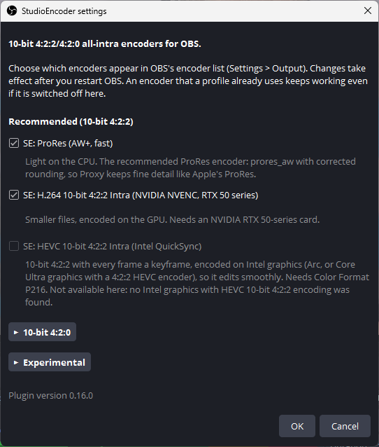

<!-- languages:start -->

<b>🌐 Language · Idioma · Langue · Sprache · Язык · 语言 · 言語 · 언어 · भाषा · لغة</b>

 

<table>
  <tr>
    <td align="center"><a href="../../README.md">English</a></td>
    <td align="center"><a href="README.ar.md">العربية</a></td>
    <td align="center"><a href="README.bn.md">বাংলা</a></td>
    <td align="center"><a href="README.zh-Hans.md">简体中文</a></td>
    <td align="center"><a href="README.fil.md">Filipino</a></td>
  </tr>
  <tr>
    <td align="center"><a href="README.fr.md">Français</a></td>
    <td align="center"><b>Deutsch</b></td>
    <td align="center"><a href="README.hi.md">हिन्दी</a></td>
    <td align="center"><a href="README.id.md">Bahasa Indonesia</a></td>
    <td align="center"><a href="README.it.md">Italiano</a></td>
  </tr>
  <tr>
    <td align="center"><a href="README.ja.md">日本語</a></td>
    <td align="center"><a href="README.ko.md">한국어</a></td>
    <td align="center"><a href="README.fa.md">فارسی</a></td>
    <td align="center"><a href="README.pt-BR.md">Português (Brasil)</a></td>
    <td align="center"><a href="README.ru.md">Русский</a></td>
  </tr>
  <tr>
    <td align="center"><a href="README.es.md">Español</a></td>
    <td align="center"><a href="README.te.md">తెలుగు</a></td>
    <td align="center"><a href="README.th.md">ไทย</a></td>
    <td align="center"><a href="README.tr.md">Türkçe</a></td>
    <td align="center"><a href="README.vi.md">Tiếng Việt</a></td>
  </tr>
</table>

<!-- languages:end -->

# StudioEncoder: schnittfreundliche Encoder für OBS Studio

> Diese Übersetzung wurde von einer KI geschrieben und nicht von Muttersprachlern geprüft. Die Namen von Menüs, Einstellungen und Encodern in OBS Studio sind hier auf Englisch angegeben, so wie OBS sie anzeigt. Maßgeblich ist die [englische README](../../README.md).

Ein OBS-Studio-Plugin für Windows, das OBS Studio 33 und neuer um All-Intra-Encoder mit 10 Bit ergänzt, für 4K-Aufnahmen in MOV, die sich flüssig schneiden lassen.

- **AW+** ist ein ProRes-kompatibler CPU-Encoder mit 10-Bit-4:2:2-Farbe. Er ist eine verbesserte Version des ProRes-Encoders von FFmpeg (`prores_aw`) und behebt einen Rundungsfehler, der das Bild im ProRes-Proxy-Modus unscharf machte. Er ist außerdem auf Geschwindigkeit optimiert und braucht daher ungefähr halb so viel CPU wie der Encoder von FFmpeg.
- **GPU-Encoder mit 10-Bit-4:2:2:** H.264 für NVIDIA-Karten der RTX-50-Serie und HEVC über Intel QuickSync (getestet auf einer Intel-Panther-Lake-CPU).
- **GPU-Encoder mit 10-Bit-4:2:0:** All-Intra-HEVC für AMD-GPUs und für NVIDIA-Karten, die älter sind als die RTX-50-Serie. OBS hat für diese GPUs bereits Hardware-HEVC-Encoder, aber StudioEncoder macht sie mit einfachen Voreinstellungen statt kryptischer Einstellungen leichter nutzbar. AMD-GPUs können kein 4:2:2 encodieren, daher bleibt es hier bei 4:2:0.

Seit OBS 33.0 hat der Weg über Custom Output (FFmpeg) einen Fehler, der hin und wieder die Meldung „non monotonically increasing dts“ auslöst und verhindern kann, dass eine neue Aufnahme startet. StudioEncoder umgeht diesen Weg: Seine Encoder laufen im Aufnahmemodus **Standard** und arbeiten daher reibungslos.

> **Nicht Apple ProRes.** Dieses Plugin ist inoffiziell und weder mit Apple verbunden noch von Apple unterstützt. Apple ProRes ist ein lizenzierter, zertifizierter Codec. Die Encoder hier sind unabhängige Implementierungen des öffentlich dokumentierten Formats (SMPTE RDD 36): `prores_aw` von FFmpeg (und der darauf aufbauende AW+-Encoder), der FilmCraft-Rust-Encoder und der OxideAV-Rust-Encoder. Ihre Ausgabe lässt sich in gängigen Schnittprogrammen wie DaVinci Resolve abspielen, ist aber nicht von Apple zertifiziert.

## Hardware

Die Aufnahmekarte entscheidet, ob du wirklich in 10-Bit-4:2:2 aufnimmst, denn sie muss 10-Bit-4:2:2 an den PC liefern.

**Karten.** Am günstigsten nimmst du 4K-10-Bit-4:2:2 an einem PC mit einer Blackmagic-Design-Intensity- oder DeckLink-Karte oder einer Magewell-Pro-Capture-Karte auf. Karten von AJA und Datapath können es auch, kosten aber deutlich mehr.

**P210 in OBS.** OBS kann das Pixelformat P210 (10-Bit-4:2:2) in seiner eigenen Quelle Video Capture Device nicht aufnehmen; sie hört bei 10-Bit-4:2:0 auf. Blackmagic-Karten (v210) funktionieren in OBS bereits über die DeckLink-Quelle. StudioEncoder ergänzt Unterstützung für Magewell-Karten und jede andere Karte, die P210 ausgibt, was OBS nie hatte. Nutze die Quelle **SE: 10-bit 4:2:2 capture (P210)**.

**PCIe-Karten.** Die Karte braucht einen Steckplatz, der mit **x4-Lanes** angebunden ist, um die volle Leistung zu erreichen. Lass sie keine Lanes mit einem M.2-Sockel oder SATA-Anschlüssen teilen, denn das kann den Steckplatz auf x2 oder x1 reduzieren. Sieh im Handbuch deines Mainboards nach.

**USB-Karten.** 4K30 in 10-Bit-4:2:2 braucht etwa 5,3 Gbit/s als gepacktes v210 oder 8,0 Gbit/s als P210. Eine 5-Gbit/s-USB-3.0-Verbindung überträgt in der Praxis nur etwa 3,5 bis 4 Gbit/s, reicht also nicht. Du brauchst einen echten 10-Gbit/s-USB-3.2-Gen-2-Anschluss, ein passendes Kabel und eine Karte, die 10-Bit-4:2:2 ausgibt, und 4K30 P210 passt gerade so hindurch. 4K60 passt auf keine USB-Verbindung. Die meisten USB-Aufnahmekarten bieten nur 8-Bit-4:2:2 oder 10-Bit-4:2:0, prüfe also vor dem Kauf die Ausgabeformate der Karte.

## Encoder

| Encoder in OBS | Implementierung | Hinweise |
|---|---|---|
| SE: ProRes (AW+, fast) | AW+: `prores_aw` von FFmpeg, ins Plugin eingebaut, mit korrigierter Rundung | **Empfohlen.** Schonend für die CPU: Auf CPUs mit AVX2 liegt sein Anteil bei etwa der Hälfte des prores_aw von FFmpeg selbst, und auf älteren oder schwachen CPUs fällt er auf reines C zurück (immer noch schneller als FFmpeg). Proxy behält feine Details; das prores_aw von FFmpeg macht Proxy unscharf. |
| ProRes-compatible (Rust / FilmCraft) (experimental) | [FilmCraft](https://github.com/storytold/filmcraft)-Rust-Encoder | Experimentell. Hohe CPU-Last bei 4K. |
| ProRes (OxideAV, pure Rust) (experimental) | [OxideAV](https://github.com/oxideav/oxideav) `oxideav-prores` | Experimentell. Bei 4K etwa das 2,5-Fache der CPU-Last von prores_aw (30 % gegenüber 12 % eines Laptops mit 22 Threads) und bei Profil 422 auf Live-Kameraaufnahmen etwa ein Drittel größere Dateien, ohne Qualitätsvorteil pro Bit. Sehr junger Code (0.1). |
| H.264 10-bit 4:2:2 Intra (NVIDIA NVENC, RTX 50 series) | FFmpeg `h264_nvenc` | Kleinere Dateien auf der GPU. Braucht eine Karte der **RTX-50-Serie**. Siehe unten. |
| HEVC 10-bit 4:2:0 Intra (NVIDIA NVENC) | FFmpeg `hevc_nvenc` | Für NVIDIA-Karten, die **älter sind als die RTX-50-Serie** (dort gibt es kein H.264 mit 10 Bit): 10-Bit-**4:2:0**, jedes Bild ein Keyframe, eine Bitrateneinstellung. Siehe unten. |
| HEVC 10-bit Intra (AMD) | FFmpeg `hevc_amf` | 10-Bit-**4:2:0**, jedes Bild ein Keyframe, auf einer Radeon-GPU, mit vier Qualitätsvoreinstellungen. Siehe unten. |

Profile: Proxy (`apco`), LT (`apcs`), 422 (`apcn`), HQ (`apch`).

### Auswahl der angezeigten Encoder (Tools > StudioEncoder)

Die Encoder-Liste von OBS bleibt standardmäßig kurz. **Tools > StudioEncoder** öffnet ein Fenster, das jeden Encoder dieses Plugins in drei Abschnitten auflistet: **Recommended (10-bit 4:2:2)** (AW+ und der H.264-Encoder für RTX 50), **10-bit 4:2:0** (die HEVC-Encoder für NVIDIA und AMD) und **Experimental** (FilmCraft und OxideAV, standardmäßig aus). Die beiden letzten sind einklappbare Gruppen, die geschlossen starten; klicke auf den kleinen Pfeil, um eine zu öffnen. Hake an, was du möchtest, und drücke OK; die Änderung gilt nach einem Neustart von OBS.

 StudioEncoder) in OBS: eine Liste von Encodern mit Kontrollkästchen und einklappbaren Gruppen für 10-bit 4:2:0 und Experimental" width="420">

Ein abgeschalteter Encoder wird nur im Dropdown ausgeblendet. Ein Profil, das ihn bereits nutzt, funktioniert weiter. Alle Encoder dieses Plugins beginnen in der Encoder-Liste von OBS mit „SE:“, damit man sie leicht erkennt.

### Warum AW+ (korrigiertes prores_aw)

Das prores_aw von FFmpeg teilt jeden Detailkoeffizienten durch seine Quantisierungsstufe und **schneidet in Richtung Null ab**, sodass alles, was kleiner als eine ganze Stufe ist, verloren geht. Bei Proxy, wo die Stufen grob sind, entfernt das feine Textur: Gesichter und Stoffe wirken verschmiert. Der Encoder von Apple nutzt dieselbe Proxy-Matrix und denselben Quantisierer, behält dieses Detail aber. AW+ ist prores_aw, ins Plugin portiert und mit Rundung statt Abschneiden (Offset je Profil: Proxy 4/8, LT 3/8, 422 3/8, HQ 2/8 einer Stufe, gewählt für die beste Qualität pro Bit).

Gemessen an einem 4K-Kameraclip (PSNR, höher ist besser):

| Profil | FFmpeg prores_aw | AW+ | Apple ProRes |
|---|---|---|---|
| Proxy | 74 Mbit/s, 54.0 dB | **94 Mbit/s, 56.2 dB** | 96 Mbit/s, 56.5 dB |
| LT | 170 Mbit/s, 59.7 dB | 198 Mbit/s, 61.6 dB | 235 Mbit/s, 62.2 dB |
| HQ | 492 Mbit/s, 71.1 dB | 560 Mbit/s, 73.5 dB | 520 Mbit/s, 72.2 dB |

Mit abgeschalteter Rundung erzeugt AW+ byteidentische Dateien wie das prores_aw von FFmpeg (an allen vier Profilen geprüft).
Die GPU-Encoder prüfen beim Start von OBS deine Grafikkarte. Kann die Karte einen davon nicht ausführen (eine NVIDIA-Karte, die älter als die RTX-50-Serie ist, beim H.264-Encoder; keine NVIDIA-Karte mit 10-Bit-HEVC beim NVIDIA-HEVC-Encoder; keine Radeon beim AMD-Encoder), wird dieser Encoder in der Liste ausgeblendet und in diesem Fenster ausgegraut angezeigt.

### H.264 10-bit 4:2:2 Intra (NVIDIA NVENC)

Eine platzsparende Alternative zu ProRes, auf der GPU encodiert. Jedes Bild ist ein Keyframe (All-Intra), High-4:2:2-Profil, 10 Bit, konstante Bitrate. Es lässt sich also wie ProRes schneiden, ist aber bei leicht geringerer Qualität kleiner.

- **Braucht eine NVIDIA-GPU der RTX-50-Serie** (Blackwell) und einen aktuellen Treiber. Ältere NVIDIA-Karten können weder H.264 mit 10 Bit noch 4:2:2 encodieren; auf ihnen startet die Aufnahme nicht, und OBS zeigt einen Fehler. Nutze dort ProRes (prores_aw).
- **Bitrate**: 100 Mbit/s (klein, etwa die Qualität von ProRes LT), **200 (Standard**, besser als ProRes LT, etwa halb so groß wie ProRes 422), 300 (hoch). Über 400 bringt nichts.
- **Speed**: Quality (p5, Standard) oder Fast (p1, etwas geringere Qualität).
- Die Bilder gehen ohne Umwandlung als P216 an die GPU. Höchstens 2 Bilder sind gleichzeitig in Arbeit, weil NVIDIA-Verbraucherkarten die Zahl der Encoder-Sitzungen begrenzen.
- In einem FFmpeg-Test auf einer RTX 5080 (4K-29,97-Kameraaufnahmen) lief das mit etwa 77 fps bei p5 und 101 fps bei p1.

### HEVC 10-bit 4:2:0 Intra (NVIDIA NVENC)

Für NVIDIA-Karten, die **älter sind als die RTX-50-Serie** (GTX 10 und neuer sollten funktionieren; getestet auf einer RTX 4070 Laptop). Diese Karten haben weder einen H.264-Modus mit 10 Bit noch 4:2:2, daher ist dies HEVC (Main 10) in **10-Bit-4:2:0**: Die Farbdetails sind halb so fein wie bei ProRes 422, aber jedes Bild ist ein Keyframe, sodass es sich wie ProRes schneiden und durchscrubben lässt, in kleineren Dateien. Auf einer RTX-50-Karte bekommst du zusätzlich den oben beschriebenen H.264-4:2:2-Encoder, der die Farbdetails behält.

- **Settings > Advanced > Color Format: P010** (nicht P216), Rec. 709, Limited. Das Bild geht so an die GPU, wie OBS es erzeugt, ohne Umwandlung.
- **Bitrate** (30 bis 400 Mbit/s, Standard 150) und **Speed** (Quality p5 oder Fast p1). In einem Test an einem 4K-Kameraclip (Luma-Qualität gegenüber der Quelle): 100 Mbit/s ergaben 57,6 dB, besser als ProRes Proxy (53,7 dB bei 95); 150 ergaben 59,4 dB, etwa so viel wie AW+ LT (59,6 dB bei 200) mit 70 % von dessen Bits; 200 ergaben 60,8 dB. Die Voreinstellung Fast ist nur etwas schlechter und auf dieser GPU etwa gleich schnell.
- Die Aufnahmen sind HEVC Main 10 in MOV mit dem Tag `hvc1` (alle Bilder Keyframes, in FFmpeg fehlerfrei decodierbar). Noch nicht in Resolve oder Premiere ausprobiert.
- Höchstens 2 Bilder werden gleichzeitig encodiert, weil NVIDIA-Verbraucherkarten die Zahl der Encoder-Sitzungen begrenzen. Etwa 15 ms pro 4K-Bild auf der RTX 4070 Laptop; OBS verbrauchte etwa 7 % der CPU (davon etwa 5 % durch die Szene selbst).

### HEVC 10-bit 4:2:0 Intra (AMD)

Für Radeon-Nutzer. Der Video-Encoder von AMD kann überhaupt kein 4:2:2 (und sein H.264-Encoder kein 10 Bit), daher ist dies **10-Bit-4:2:0**: Die Farbdetails sind halb so fein wie bei ProRes 422. Jedes Bild ist ein Keyframe, sodass sich jedes Bild wie bei ProRes schneiden und durchscrubben lässt, ohne Nachbarbilder zu decodieren, in viel kleineren Dateien (High ist beim Testclip etwa ein Drittel von ProRes 422). Das „AMD HW H.265 (HEVC)“ von OBS kann ebenfalls in 10 Bit aufnehmen, braucht aber eine normale GOP und Bitraten-Feinabstimmung; dieser Encoder ersetzt das durch eine einzige Wahl, **Quality**.

- **Settings > Advanced > Color Format: P010** (nicht P216), Rec. 709, Limited.
- **Quality** ist konstant, die Dateigröße hängt also vom Bild ab. Typische Größen für 4K-29,97-Kameraaufnahmen:

| Preset | Größe | Luma-PSNR an einem 4K-Kameraclip |
|---|---|---|
| Small | etwa 30 Mbit/s | 52,4 dB |
| Standard | etwa 70 Mbit/s | 55,3 dB (ProRes LT: 56,2 dB bei 169 Mbit/s) |
| **High** (Standard) | etwa 120 Mbit/s | 56,7 dB |
| Maximum | etwa 170 Mbit/s | 57,8 dB (die Obergrenze des Encoders) |

  Die PSNR-Werte vergleichen mit dem in 4:2:0 umgewandelten Kameraclip und sind daher fair für diesen Encoder; ProRes behält 4:2:2-Farbe, die dieser nicht kann. Verrauschtes Material ergibt bei gleicher Voreinstellung größere Dateien.
- Gemessen auf einer Radeon RX 9070 XT: etwa 3,8 ms pro 4K-Bild, keine wiederholten Bilder bei 4K 29,97. Der AMD-Encoder gibt jedes Paket ein Bild zu spät zurück, daher wird das letzte Bild vor dem Drücken von Stop verworfen.
- Die Aufnahmen sind HEVC Main 10 in MOV (alle Bilder Keyframes, gleichmäßige Zeitstempel, in FFmpeg fehlerfrei decodierbar). Noch nicht in Resolve oder Premiere ausprobiert.

## 10-Bit-4:2:2-Aufnahme (P210), Windows

Die eigene Quelle Video Capture Device von OBS kann kein 10-Bit-4:2:2 einlesen: Ihre DirectShow-Aufnahme hört bei P010 (10-Bit-4:2:0) auf. Manche Aufnahmekarten, etwa Magewell Pro Capture, bieten 10-Bit-4:2:2 als P210 an. StudioEncoder ergänzt dafür eine Quelle: **Sources > + > SE: 10-bit 4:2:2 capture (P210)**.

- Wähle die Karte unter Device oder lass es bei „First device that offers P210“.
- Stelle Resolution und Frame rate passend zum HDMI-Signal der Kamera ein (Standard 3840x2160, 29.97).
- Stelle **Settings > Video > Advanced > Color Format auf P216**, damit die 10 Bit den Encoder erreichen. Mit P216 mischt OBS die Szene in 16-Bit-Gleitkomma.
- Füge den Ton der Karte mit einer separaten Quelle Audio Input Capture hinzu.

Die Bilder werden für OBS von P210 in I210 umgewandelt: eine verlustfreie Verschiebung und Aufteilung der Ebenen, etwa 2,4 ms pro 4K-Bild auf einem Ryzen 9 9950X3D. Getestet mit einer Magewell Pro Capture HDMI 4K bei 3840x2160 29.97: keine wiederholten Bilder, und die Samples tragen echte 10-Bit-Werte. `tools/p210-probe.cpp` ist ein kleines Kommandozeilenprogramm, das prüft, ob die P210-Ausgabe einer Karte echte 10-Bit-Daten enthält.

## Voraussetzungen

- Windows 10/11 x64
- OBS Studio 33.0.x (gebaut gegen 33.0.0; getestet mit 33.0.1)

## Installation

Schließe OBS und kopiere dann den Ordner `obs-studioencoder` aus der Release-ZIP:

- **Installiertes OBS:** nach `C:\ProgramData\obs-studio\plugins\obs-studioencoder\`. `ProgramData` ist versteckt; gib den Pfad in den Datei-Explorer ein.
- **Portables OBS:** nach `<OBS folder>\plugins\obs-studioencoder\`, neben `bin`, `data` und `config`.

Der Ordner muss `obs-studioencoder.dll` und `data\locale\` enthalten. In OBS sollte unter Tools → Plugin Manager „StudioEncoder“ aufgeführt sein, und Tools → StudioEncoder öffnet die Einstellungen.

Nutze nicht die alten Ordner `obs-plugins\64bit` oder `data\obs-plugins`. OBS 33 kennzeichnet diese Orte als veraltet.

## Einstellungen

1. Settings → Advanced: **Color Format P216** (**P010** für die beiden HEVC-Encoder), Color Space Rec. 709, Color Range Limited.

   

2. Settings → Video: Stelle die Leinwand (Base) und die Ausgabeauflösung (Output) auf deine Aufnahmegröße und die Bildrate passend zu deiner Quelle ein. Der Screenshot zeigt 3840x2160 bei 29.97.

   

3. Settings → Output: Output Mode **Advanced**, Reiter Recording, Type **Standard**, Recording Format **MOV**.
4. Video Encoder: einer der oben genannten Encoder (er beginnt mit „SE:“). Die Zeile unter Encoder Settings, „Required video settings“, wiederholt Color Format, Color Space und Color Range, die dieser Encoder braucht.

   

   In seinen Einstellungen:
   - **Profile** (ProRes-Encoder): Proxy, LT, 422 oder HQ. **Bitrate** und **Speed** (NVENC-Encoder): siehe oben.
   - **Frames in flight**: 0 (automatisch, empfohlen). Die Bilder werden bei Bedarf parallel encodiert, eines pro CPU-Kern.
   - **Automatic sizing** (nur mit Frames in flight 0): *Grow when frames are late* (Standard) oder *Size from measured frame cost* (experimentell). Die zweite Option startet mit 4 Workern, misst ein Bild und stellt dann die nötige Zahl von Workern in einem Schritt ein. Das braucht bei leichten Encodern weniger Speicher und fährt bei schweren schneller hoch. Die CPU-Last ist in beiden Fällen gleich.
   - **On overload**: *Warn in the log* oder *Stop recording*.
   - **Log verbosity**: Info zeigt Zeitmessungen und die automatische Abstimmung.

## Überlastung

Kann ein Encoder nicht mithalten, wiederholt OBS das vorherige Bild, um die Zeitleiste zu halten, und die Aufnahme wirkt an diesen Stellen eingefroren. Das Plugin zählt diese wiederholten Bilder für jede Aufnahme (es bemerkt, wenn OBS ihm dasselbe Bild zweimal hintereinander gibt):
- Es schreibt für jede Sekunde, in der das passiert, eine `OVERLOAD`-Warnung ins Log und am Ende der Aufnahme eine Zusammenfassung.
- Mit **On overload: Stop recording** beendet es die Aufnahme nach 3 überlasteten Sekunden in Folge und zeigt einen Fehler.

Wenn du Überlastungswarnungen siehst, wechsle zum prores_aw-Encoder oder zu einem leichteren Profil.

## Bekannte Einschränkungen

- Die Eingabe muss P216 sein (P010 bei den HEVC-Encodern). OBS 33 bietet kein anderes 10-Bit-4:2:2-Ausgabeformat.
- Bilder, die nach dem Drücken von Stop aufgenommen wurden, aber noch encodiert werden, werden verworfen. Das ist erwartet; die Aufnahme endet am Stoppunkt.
- Hybrid MOV ist ungetestet.
- Windows. Linux lässt sich bauen und läuft (getestet auf Ubuntu und CachyOS; siehe `docs/HANDOFF.md`, „Build and test on Linux“ und „Linux results“).

## Bauen

Hinweise zum Bauen (Toolchain und Build-Schritte) stehen nur in der [englischen README](../../README.md#build).

## Lizenz

GPL-2.0-or-later (siehe `LICENSE`), wie für OBS-Plugins vorgeschrieben. Code von Drittanbietern:
- FFmpeg (LGPL), wie mit OBS ausgeliefert.
- FilmCraft-ProRes-Crate (MIT OR Apache-2.0, verwendet unter MIT).
- AW+ (`src/prores-aw.c`): eine Portierung des prores_aw-Encoders von FFmpeg, der Vorwärts-DCT und der ProRes-Tabellen (LGPL 2.1 oder später; Anatoliy Wasserman, Konstantin Shishkov, Independent JPEG Group), verwendet unter der GPL.
- `oxideav-prores` und `oxideav-core` (MIT), der OxideAV-ProRes-Encoder.
