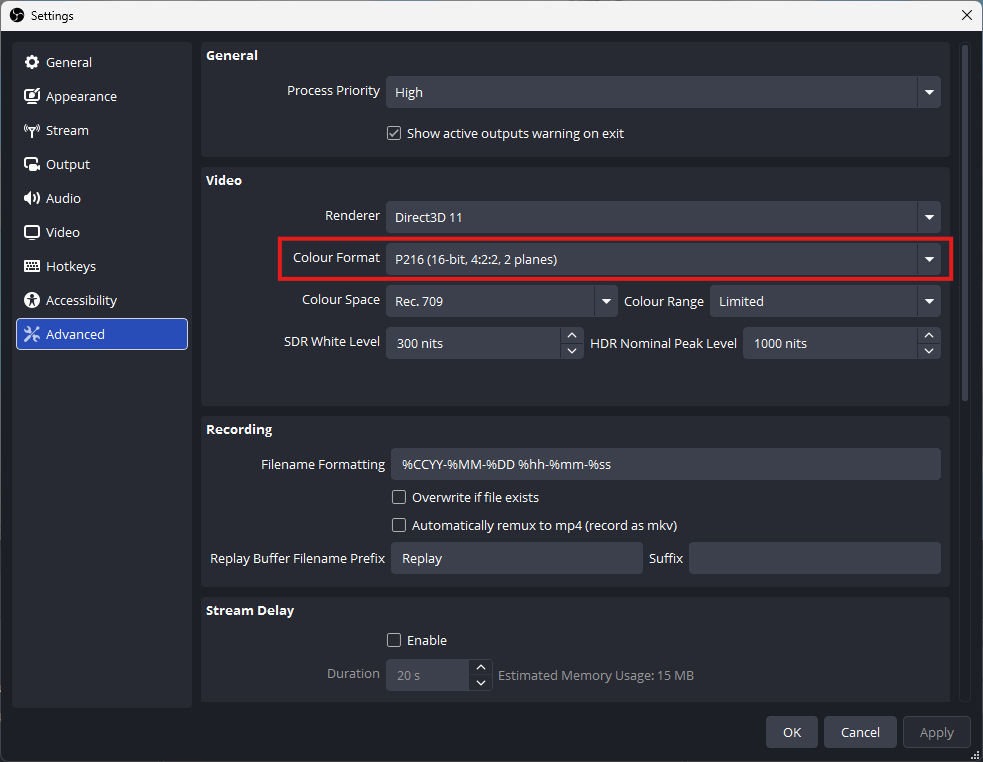

<!-- languages:start -->

<b>🌐 Language · Idioma · Langue · Sprache · Язык · 语言 · 言語 · 언어 · भाषा · لغة</b>

 

<table>
  <tr>
    <td align="center"><a href="../../README.md">English</a></td>
    <td align="center"><a href="README.ar.md">العربية</a></td>
    <td align="center"><a href="README.bn.md">বাংলা</a></td>
    <td align="center"><a href="README.zh-Hans.md">简体中文</a></td>
    <td align="center"><b>Filipino</b></td>
  </tr>
  <tr>
    <td align="center"><a href="README.fr.md">Français</a></td>
    <td align="center"><a href="README.de.md">Deutsch</a></td>
    <td align="center"><a href="README.hi.md">हिन्दी</a></td>
    <td align="center"><a href="README.id.md">Bahasa Indonesia</a></td>
    <td align="center"><a href="README.it.md">Italiano</a></td>
  </tr>
  <tr>
    <td align="center"><a href="README.ja.md">日本語</a></td>
    <td align="center"><a href="README.ko.md">한국어</a></td>
    <td align="center"><a href="README.fa.md">فارسی</a></td>
    <td align="center"><a href="README.pt-BR.md">Português (Brasil)</a></td>
    <td align="center"><a href="README.ru.md">Русский</a></td>
  </tr>
  <tr>
    <td align="center"><a href="README.es.md">Español</a></td>
    <td align="center"><a href="README.te.md">తెలుగు</a></td>
    <td align="center"><a href="README.th.md">ไทย</a></td>
    <td align="center"><a href="README.tr.md">Türkçe</a></td>
    <td align="center"><a href="README.vi.md">Tiếng Việt</a></td>
  </tr>
</table>

<!-- languages:end -->

# StudioEncoder: mga encoder na madaling i-edit para sa OBS Studio

> Ang salin na ito ay isinulat ng isang AI at hindi pa nasusuri ng mga native speaker. Naka-Ingles ang mga pangalan ng menu, setting, at encoder ng OBS Studio, ayon sa pagkakaipakita ng OBS. Ang batayang teksto ay ang [README sa Ingles](../../README.md).

Isang plugin ng OBS Studio para sa Windows na nagdaragdag ng mga all-intra, 10-bit na encoder sa OBS Studio 33 pataas, para sa 4K na pag-record sa MOV na maayos i-edit.

- Ang **AW+** ay isang CPU encoder na tugma sa ProRes, na may 10-bit 4:2:2 na kulay. Ito ay pinahusay na bersyon ng ProRes encoder ng FFmpeg (`prores_aw`) at inaayos ang isang bug sa pag-round na nagpapalabo sa footage sa ProRes Proxy mode. Na-optimize rin ito para sa bilis, kaya halos kalahati lang ng CPU ng encoder ng FFmpeg ang gamit nito.
- **Mga GPU encoder na may 10-bit 4:2:2:** H.264 para sa mga NVIDIA card ng RTX 50 series, at HEVC sa pamamagitan ng Intel QuickSync (nasubukan sa isang Intel Panther Lake CPU).
- **Mga GPU encoder na may 10-bit 4:2:0:** all-intra HEVC para sa mga AMD GPU at para sa mga NVIDIA card na mas luma sa RTX 50 series. May hardware HEVC encoder na ang OBS para sa mga GPU na ito, pero ginagawa ng StudioEncoder na mas madali itong gamitin, gamit ang mga simpleng preset sa halip na mga komplikadong setting. Hindi kayang mag-encode ng 4:2:2 ng mga AMD GPU, kaya nananatiling 4:2:0 ang mga ito.

Mula sa OBS 33.0, may bug ang Custom Output (FFmpeg) na landas na paminsan-minsang nagdudulot ng error na «non monotonically increasing dts» at maaaring pigilan ang pagsisimula ng bagong recording. Iniiwasan ito ng StudioEncoder: tumatakbo ang mga encoder nito sa **Standard** na recording mode, kaya maayos ang takbo.

> **Hindi ito Apple ProRes.** Hindi opisyal ang plugin na ito at hindi ito kaanib o inendorso ng Apple. Ang Apple ProRes ay lisensyado at sertipikadong codec. Ang mga encoder dito ay mga independiyenteng implementasyon ng pampublikong dokumentadong format (SMPTE RDD 36): ang `prores_aw` ng FFmpeg (at ang AW+ encoder na hinango rito), ang FilmCraft Rust encoder, at ang OxideAV Rust encoder. Nagpe-play ang output nila sa mga karaniwang editor, tulad ng DaVinci Resolve, pero hindi ito sertipikado ng Apple.

## Hardware

Ang capture card ang nagpapasya kung talagang 10-bit 4:2:2 ang nire-record mo, dahil kailangan nitong maghatid ng 10-bit 4:2:2 sa PC.

**Mga card.** Ang pinakamurang paraan para mag-capture ng 4K 10-bit 4:2:2 sa PC ay isang Blackmagic Design Intensity o DeckLink card, o isang Magewell Pro Capture card. Magagawa rin ito ng mga AJA at Datapath card, pero mas mahal nang malaki.

**P210 sa OBS.** Hindi makakapag-capture ang OBS ng P210 pixel format (10-bit 4:2:2) sa sarili nitong Video Capture Device source, na humihinto sa 10-bit 4:2:0. Gumagana na sa OBS ang mga Blackmagic card (v210) sa pamamagitan ng DeckLink source nito. Nagdaragdag ang StudioEncoder ng suporta para sa mga Magewell card at anumang ibang card na naglalabas ng P210, na hindi pa nagkaroon ang OBS. Gamitin ang source na **SE: 10-bit 4:2:2 capture (P210)**.

**Mga PCIe card.** Kailangan ng card ng slot na may **x4 lanes** para tumakbo nang buo ang kapasidad. Huwag hayaang magbahagi ito ng lanes sa isang M.2 socket o SATA port, na maaaring magpababa sa slot sa x2 o x1. Tingnan ang manual ng motherboard mo.

**Mga USB card.** Ang 4K30 10-bit 4:2:2 ay nangangailangan ng humigit-kumulang 5.3 Gbit/s bilang naka-pack na v210, o 8.0 Gbit/s bilang P210. Ang 5 Gbit/s na USB 3.0 link ay nakakapagdala lang ng mga 3.5 hanggang 4 Gbit/s sa praktika, kaya hindi nito kaya ito. Kailangan mo ng tunay na 10 Gbit/s USB 3.2 Gen 2 port, angkop na cable, at card na naglalabas ng 10-bit 4:2:2, at halos hindi lang magkakasya ang 4K30 P210. Hindi kasya ang 4K60 sa anumang USB link. Karamihan sa mga USB capture card ay 8-bit 4:2:2 o 10-bit 4:2:0 lang ang inaalok, kaya tingnan ang mga output format ng card bago bumili.

## Mga encoder

| Encoder sa OBS | Implementasyon | Mga tala |
|---|---|---|
| SE: ProRes (AW+, fast) | AW+: `prores_aw` ng FFmpeg na isinama sa plugin, na may inayos na pag-round | **Inirerekomenda.** Magaan sa CPU: sa mga CPU na may AVX2, mga kalahati ng sa prores_aw ng FFmpeg mismo ang bahagi nito, at bumabalik sa plain C (mas mabilis pa rin kaysa sa FFmpeg) sa mga luma o mahinang CPU. Pinapanatili ng Proxy ang pinong detalye; pinapalabo ng prores_aw ng FFmpeg ang Proxy. |
| ProRes-compatible (Rust / FilmCraft) (experimental) | [FilmCraft](https://github.com/storytold/filmcraft) Rust encoder | Eksperimental. Mabigat sa CPU sa 4K. |
| ProRes (OxideAV, pure Rust) (experimental) | [OxideAV](https://github.com/oxideav/oxideav) `oxideav-prores` | Eksperimental. Mga 2.5 beses ang CPU ng prores_aw sa 4K (30% laban sa 12% ng isang 22-thread na laptop) at mga isang-katlo na mas malaking file sa profile 422 sa live na footage ng camera, na walang bentahe sa kalidad kada bit. Napakabatang code (0.1). |
| H.264 10-bit 4:2:2 Intra (NVIDIA NVENC, RTX 50 series) | FFmpeg `h264_nvenc` | Mas maliliit na file sa GPU. Kailangan ng card ng **RTX 50 series**. Tingnan sa ibaba. |
| HEVC 10-bit 4:2:0 Intra (NVIDIA NVENC) | FFmpeg `hevc_nvenc` | Para sa mga NVIDIA card na **mas luma sa RTX 50 series** (walang 10-bit H.264 doon): 10-bit **4:2:0**, bawat frame ay keyframe, isang bitrate setting. Tingnan sa ibaba. |
| HEVC 10-bit Intra (AMD) | FFmpeg `hevc_amf` | 10-bit **4:2:0**, bawat frame ay keyframe, sa isang Radeon GPU, na may apat na quality preset. Tingnan sa ibaba. |

Mga profile: Proxy (`apco`), LT (`apcs`), 422 (`apcn`), HQ (`apch`).

### Pagpili kung aling mga encoder ang lalabas (Tools > StudioEncoder)

Maikli ang listahan ng encoder ng OBS bilang default. Binubuksan ng **Tools > StudioEncoder** ang isang window na naglilista ng bawat encoder sa plugin na ito sa tatlong seksyon: **Recommended (10-bit 4:2:2)** (AW+ at ang RTX 50 H.264 encoder), **10-bit 4:2:0** (ang mga HEVC encoder ng NVIDIA at AMD) at **Experimental** (FilmCraft at OxideAV, naka-off bilang default). Ang huling dalawa ay mga collapsible na grupo na nakasara sa simula; i-click ang maliit na arrow para magbukas ng isa. Lagyan ng tsek ang gusto mo at pindutin ang OK; may bisa ang pagbabago pagkatapos mag-restart ng OBS.

 StudioEncoder) sa OBS: isang listahan ng mga encoder na may mga checkbox at collapsible na grupong 10-bit 4:2:0 at Experimental" width="420">

Nakatago lang sa dropdown ang isang encoder na naka-off. Patuloy na gumagana ang isang profile na gumagamit na nito. Nagsisimula sa «SE:» ang lahat ng encoder mula sa plugin na ito sa listahan ng encoder ng OBS para madaling makita.

### Bakit AW+ (inayos na prores_aw)

Hinahati ng prores_aw ng FFmpeg ang bawat detail coefficient sa quantiser step nito at **pinuputol papunta sa zero**, kaya nawawala ang anumang mas maliit sa isang buong step. Sa Proxy, kung saan magaspang ang mga step, inaalis nito ang pinong texture: nagmumukhang malabo ang mga mukha at tela. Gumagamit ang encoder ng Apple ng parehong Proxy matrix at quantiser pero pinapanatili ang detalyeng iyon. Ang AW+ ay prores_aw na inilipat sa plugin na may pag-round sa halip na pagputol (offset kada profile: Proxy 4/8, LT 3/8, 422 3/8, HQ 2/8 ng isang step, pinili para sa pinakamagandang kalidad kada bit).

Sinukat sa isang 4K na camera clip (PSNR, mas mataas ay mas maganda):

| Profile | FFmpeg prores_aw | AW+ | Apple ProRes |
|---|---|---|---|
| Proxy | 74 Mbit/s, 54.0 dB | **94 Mbit/s, 56.2 dB** | 96 Mbit/s, 56.5 dB |
| LT | 170 Mbit/s, 59.7 dB | 198 Mbit/s, 61.6 dB | 235 Mbit/s, 62.2 dB |
| HQ | 492 Mbit/s, 71.1 dB | 560 Mbit/s, 73.5 dB | 520 Mbit/s, 72.2 dB |

Kapag naka-off ang pag-round, gumagawa ang AW+ ng mga file na magkaparehong-magkapareho sa byte sa mga file ng prores_aw ng FFmpeg (nasuri sa lahat ng apat na profile).
Sinusuri ng mga GPU encoder ang graphics card mo sa pagsisimula ng OBS. Kung hindi kayang patakbuhin ng card ang isa (isang NVIDIA card na mas luma sa RTX 50 series para sa H.264 encoder, walang NVIDIA card na may 10-bit HEVC para sa NVIDIA HEVC encoder, walang Radeon para sa AMD), itinatago ang encoder na iyon sa listahan at ipinapakitang kulay-abo sa window na ito.

### H.264 10-bit 4:2:2 Intra (NVIDIA NVENC)

Isang alternatibo sa ProRes na nakakatipid ng espasyo, na ine-encode sa GPU. Bawat frame ay keyframe (all-intra), High 4:2:2 profile, 10-bit, constant bitrate, kaya ine-edit ito na parang ProRes pero mas maliit, na may maliit na kapalit sa kalidad.

- **Kailangan ng NVIDIA RTX 50-series GPU** (Blackwell) at kasalukuyang driver. Hindi kayang mag-encode ng 10-bit H.264 o 4:2:2 ang mga mas lumang NVIDIA card; sa mga iyon, hindi magsisimula ang recording at magpapakita ng error ang OBS. Gamitin doon ang ProRes (prores_aw).
- **Bitrate**: 100 Mbit/s (maliit, mga kalidad ng ProRes LT), **200 (default**, mas maganda kaysa ProRes LT, mga kalahati ng laki ng ProRes 422), 300 (mataas). Walang idinadagdag ang higit sa 400.
- **Speed**: Quality (p5, default) o Fast (p1, bahagyang mas mababang kalidad).
- Dumadaan ang mga frame sa GPU bilang P216 nang walang conversion. Pinakamarami ang 2 frame na sabay na pinoproseso, dahil nililimitahan ng mga consumer NVIDIA card ang bilang ng mga encoder session.
- Sa isang FFmpeg test sa RTX 5080 (4K 29.97 na footage ng camera), tumakbo ito sa mga 77 fps sa p5 at 101 fps sa p1.

### HEVC 10-bit 4:2:0 Intra (NVIDIA NVENC)

Para sa mga NVIDIA card na **mas luma sa RTX 50 series** (dapat gumana ang GTX 10 series pataas; nasubukan sa RTX 4070 Laptop). Walang 10-bit H.264 mode at walang 4:2:2 ang mga card na iyon, kaya ito ay **10-bit 4:2:0** HEVC (Main 10): kalahati ng napapanatili ng ProRes 422 ang detalye ng kulay, pero bawat frame ay keyframe, kaya naku-cut at nai-scrub ito na parang ProRes, sa mas maliliit na file. Sa isang RTX 50 card, makukuha mo rin ang H.264 4:2:2 encoder sa itaas, na nagpapanatili ng detalye ng kulay.

- **Settings > Advanced > Color Format: P010** (hindi P216), Rec. 709, Limited. Ipinapasa sa GPU ang larawan ayon sa gawa ng OBS, nang walang conversion.
- **Bitrate** (30 hanggang 400 Mbit/s, default 150) at **Speed** (Quality p5, o Fast p1). Sa isang test sa isang 4K camera clip (luma quality laban sa source): 100 Mbit/s ay sumukat ng 57.6 dB, mas maganda kaysa ProRes Proxy (53.7 dB sa 95); 150 ay sumukat ng 59.4 dB, halos pareho sa AW+ LT (59.6 dB sa 200) na may 70% ng mga bit nito; 200 ay sumukat ng 60.8 dB. Bahagya lang na mas mababa ang kalidad ng Fast preset at halos kasing-bilis sa GPU na iyon.
- Ang mga recording ay HEVC Main 10 sa MOV na may `hvc1` tag (lahat ng frame ay keyframe, nade-decode nang walang error sa FFmpeg). Hindi pa nasusubukan sa Resolve o Premiere.
- Pinakamarami ang 2 frame na sabay na ine-encode, dahil nililimitahan ng mga consumer NVIDIA card ang bilang ng mga encoder session. Mga 15 ms kada 4K na frame sa RTX 4070 Laptop; gumamit ang OBS ng mga 7% ng CPU (mga 5% nito ay ang eksena mismo).

### HEVC 10-bit 4:2:0 Intra (AMD)

Para sa mga gumagamit ng Radeon. Hindi talaga kayang mag-4:2:2 ng video encoder ng AMD (at hindi kayang mag-10-bit ng H.264 encoder nito), kaya ito ay **10-bit 4:2:0**: kalahati ng napapanatili ng ProRes 422 ang detalye ng kulay. Bawat frame ay keyframe, kaya maaaring i-cut at i-scrub ang bawat frame nang hindi dinedecode ang mga katabi, tulad ng sa ProRes, sa mas maliliit na file (ang High ay mga isang-katlo ng ProRes 422 sa test clip). Kayang mag-record ng 10-bit ang sariling «AMD HW H.265 (HEVC)» ng OBS, pero kailangan nito ng normal na GOP at pag-tune ng bitrate; pinapalitan ito ng encoder na ito ng iisang pagpipilian, ang **Quality**.

- **Settings > Advanced > Color Format: P010** (hindi P216), Rec. 709, Limited.
- Pare-pareho ang **Quality**, kaya nakadepende sa larawan ang laki ng file. Karaniwang laki para sa 4K 29.97 na footage ng camera:

| Preset | Laki | Luma PSNR sa isang 4K camera clip |
|---|---|---|
| Small | mga 30 Mbit/s | 52.4 dB |
| Standard | mga 70 Mbit/s | 55.3 dB (ProRes LT: 56.2 dB sa 169 Mbit/s) |
| **High** (default) | mga 120 Mbit/s | 56.7 dB |
| Maximum | mga 170 Mbit/s | 57.8 dB (ang kisame ng encoder) |

  Inihahambing ang mga PSNR figure sa camera clip na na-convert sa 4:2:0, kaya patas ang mga ito para sa encoder na ito; pinapanatili ng ProRes ang 4:2:2 na kulay na hindi kaya nito. Ang maingay na footage ay gumagawa ng mas malalaking file sa parehong preset.
- Sinukat sa Radeon RX 9070 XT: mga 3.8 ms kada 4K na frame, walang paulit-ulit na frame sa 4K 29.97. Ibinabalik ng AMD encoder ang bawat packet nang huli ng isang frame, kaya itinatapon ang huling frame bago mo pindutin ang Stop.
- Ang mga recording ay HEVC Main 10 sa MOV (lahat ng frame ay keyframe, steady ang timestamp, nade-decode nang walang error sa FFmpeg). Hindi pa nasusubukan sa Resolve o Premiere.

## 10-bit 4:2:2 capture (P210), Windows

Hindi makapagpapasok ng 10-bit 4:2:2 ang sariling Video Capture Device source ng OBS: humihinto ang DirectShow capture nito sa P010 (10-bit 4:2:0). Ang ilang capture card, tulad ng Magewell Pro Capture, ay nag-aalok ng 10-bit 4:2:2 bilang P210. Nagdaragdag ang StudioEncoder ng source para sa mga ito: **Sources > + > SE: 10-bit 4:2:2 capture (P210)**.

- Piliin ang card sa Device, o iwanan sa «First device that offers P210».
- Itakda ang Resolution at Frame rate para tumugma sa HDMI signal ng camera (default 3840x2160, 29.97).
- Itakda ang **Settings > Video > Advanced > Color Format sa P216** para makarating ang 10 bit sa encoder. Sa P216, hinahalo ng OBS ang eksena sa 16-bit floating point.
- Idagdag ang audio ng card gamit ang hiwalay na Audio Input Capture source.

Kino-convert ang mga frame mula P210 papuntang I210 para sa OBS: isang lossless na shift at paghihiwalay ng plane, mga 2.4 ms kada 4K na frame sa isang Ryzen 9 9950X3D. Nasubukan sa Magewell Pro Capture HDMI 4K sa 3840x2160 29.97: walang paulit-ulit na frame, at may tunay na 10-bit na halaga ang mga sample. Ang `tools/p210-probe.cpp` ay isang maliit na command-line program na sumusuri kung tunay na 10-bit data ang laman ng P210 output ng isang card.

## Mga kinakailangan

- Windows 10/11 x64
- OBS Studio 33.0.x (binuo laban sa 33.0.0; nasubukan sa 33.0.1)

## Pag-install

Isara ang OBS, tapos kopyahin ang folder na `obs-studioencoder` mula sa release zip:

- **Naka-install na OBS:** sa `C:\ProgramData\obs-studio\plugins\obs-studioencoder\`. Nakatago ang `ProgramData`; i-type ang path sa File Explorer.
- **Portable na OBS:** sa `<OBS folder>\plugins\obs-studioencoder\`, katabi ng `bin`, `data`, at `config`.

Dapat naglalaman ang folder ng `obs-studioencoder.dll` at `data\locale\`. Sa OBS, dapat ilista ng Tools → Plugin Manager ang «StudioEncoder», at binubuksan ng Tools → StudioEncoder ang mga setting nito.

Huwag gamitin ang mga lumang folder na `obs-plugins\64bit` o `data\obs-plugins`. Minamarkahan ng OBS 33 ang mga lokasyong iyon bilang legacy.

## Mga setting

1. Settings → Advanced: **Color Format P216** (**P010** para sa dalawang HEVC encoder), Color Space Rec. 709, Color Range Limited.

   

2. Settings → Video: itakda ang canvas (Base) at Output resolution sa laki ng recording mo at ang frame rate para tumugma sa source mo. Ipinapakita ng screenshot ang 3840x2160 sa 29.97.

   

3. Settings → Output: Output Mode **Advanced**, Recording tab, Type **Standard**, Recording Format **MOV**.
4. Video Encoder: isa sa mga encoder sa itaas (nagsisimula sa «SE:»). Inuulit ng linya sa ilalim ng Encoder Settings, ang «Required video settings», ang Color Format, Color Space at Color Range na kailangan ng encoder na ito.

   

   Sa mga setting nito:
   - **Profile** (mga ProRes encoder): Proxy, LT, 422 o HQ. **Bitrate** at **Speed** (NVENC encoder): tingnan sa itaas.
   - **Frames in flight**: 0 (awtomatiko, inirerekomenda). Ine-encode nang parallel ang mga frame, isa kada CPU core, ayon sa pangangailangan.
   - **Automatic sizing** (kapag 0 lang ang Frames in flight): *Grow when frames are late* (default) o *Size from measured frame cost* (eksperimental). Nagsisimula ang pangalawa sa 4 na worker, ine-time ang isang frame, saka itinatakda ang kailangang bilang ng worker sa isang hakbang. Mas kaunting memory ang gamit nito para sa magagaan na encoder at mas mabilis umakyat para sa mabibigat. Pareho ang CPU load sa dalawa.
   - **On overload**: *Warn in the log* o *Stop recording*.
   - **Log verbosity**: Ipinapakita ng Info ang timing at awtomatikong tuning.

## Overload

Kapag hindi makasabay ang isang encoder, inuulit ng OBS ang naunang frame para mapanatili ang timeline, at mukhang nakatigil ang recording sa mga bahaging iyon. Binibilang ng plugin ang mga paulit-ulit na frame na iyon para sa bawat recording (napapansin nito kapag dalawang beses na magkasunod ibinigay ng OBS ang parehong frame):
- Nagsusulat ito ng `OVERLOAD` na babala sa log para sa bawat segundong nangyayari iyon, at isang buod pagkatapos ng recording.
- Sa **On overload: Stop recording**, tinatapos nito ang recording pagkatapos ng 3 magkakasunod na segundong overload at nagpapakita ng error.

Kung makakita ka ng mga babala ng overload, lumipat sa prores_aw encoder o sa mas magaang na profile.

## Mga kilalang limitasyon

- Dapat P216 ang input (P010 para sa mga HEVC encoder). Walang ibang 10-bit 4:2:2 output format ang OBS 33.
- Itinatapon ang mga frame na na-capture pagkatapos mong pindutin ang Stop pero ine-encode pa. Inaasahan ito; nagtatapos ang recording sa stop point.
- Hindi pa nasusubukan ang hybrid MOV.
- Windows. Nagbi-build at tumatakbo ang Linux (nasubukan sa Ubuntu at CachyOS; tingnan ang `docs/HANDOFF.md`, «Build and test on Linux» at «Linux results»).

## Pag-build

Nasa [README sa Ingles](../../README.md#build) lang ang mga tagubilin sa pag-build (toolchain at mga hakbang).

## Lisensya

GPL-2.0-or-later (tingnan ang `LICENSE`), ayon sa kinakailangan para sa mga OBS plugin. Code ng third party:
- FFmpeg (LGPL), gaya ng kasama sa OBS.
- FilmCraft ProRes crate (MIT OR Apache-2.0, ginagamit sa ilalim ng MIT).
- AW+ (`src/prores-aw.c`): isang port ng prores_aw encoder ng FFmpeg, ang forward DCT, at ang mga ProRes table (LGPL 2.1 o mas bago; Anatoliy Wasserman, Konstantin Shishkov, Independent JPEG Group), ginagamit sa ilalim ng GPL.
- `oxideav-prores` at `oxideav-core` (MIT), ang OxideAV ProRes encoder.
