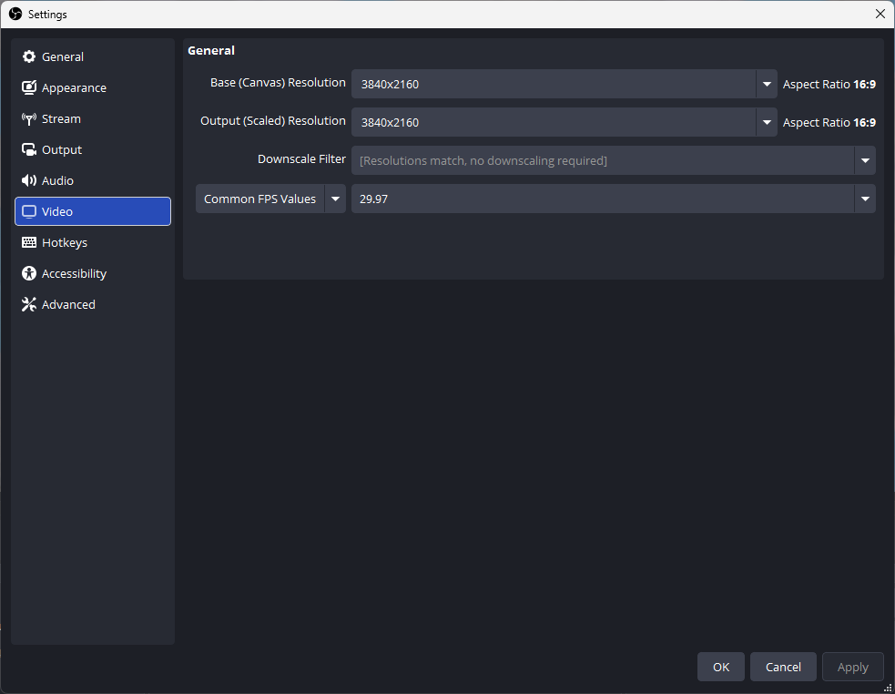

<!-- languages:start -->

<b>🌐 Language · Idioma · Langue · Sprache · Язык · 语言 · 言語 · 언어 · भाषा · لغة</b>

 

<table>
  <tr>
    <td align="center"><a href="../../README.md">English</a></td>
    <td align="center"><a href="README.ar.md">العربية</a></td>
    <td align="center"><a href="README.bn.md">বাংলা</a></td>
    <td align="center"><a href="README.zh-Hans.md">简体中文</a></td>
    <td align="center"><a href="README.fil.md">Filipino</a></td>
  </tr>
  <tr>
    <td align="center"><a href="README.fr.md">Français</a></td>
    <td align="center"><a href="README.de.md">Deutsch</a></td>
    <td align="center"><a href="README.hi.md">हिन्दी</a></td>
    <td align="center"><a href="README.id.md">Bahasa Indonesia</a></td>
    <td align="center"><a href="README.it.md">Italiano</a></td>
  </tr>
  <tr>
    <td align="center"><a href="README.ja.md">日本語</a></td>
    <td align="center"><a href="README.ko.md">한국어</a></td>
    <td align="center"><a href="README.fa.md">فارسی</a></td>
    <td align="center"><b>Português (Brasil)</b></td>
    <td align="center"><a href="README.ru.md">Русский</a></td>
  </tr>
  <tr>
    <td align="center"><a href="README.es.md">Español</a></td>
    <td align="center"><a href="README.te.md">తెలుగు</a></td>
    <td align="center"><a href="README.th.md">ไทย</a></td>
    <td align="center"><a href="README.tr.md">Türkçe</a></td>
    <td align="center"><a href="README.vi.md">Tiếng Việt</a></td>
  </tr>
</table>

<!-- languages:end -->

# StudioEncoder: encoders pensados para edição no OBS Studio

> Esta tradução foi escrita por uma IA e não foi revisada por falantes nativos. Os nomes de menus, configurações e encoders do OBS Studio aparecem em inglês, como o OBS os mostra. O texto de referência é o [README em inglês](../../README.md).

Um plugin do OBS Studio para Windows que adiciona ao OBS Studio 33 e posteriores encoders all-intra de 10 bits, para gravações 4K em MOV que editam com fluidez.

- **AW+** é um encoder de CPU compatível com ProRes, com cor de 10 bits 4:2:2. É uma versão melhorada do encoder ProRes do FFmpeg (`prores_aw`) e corrige um erro de arredondamento que deixava a imagem borrada no modo ProRes Proxy. Também é otimizado para velocidade, então usa cerca de metade da CPU do encoder do FFmpeg.
- **Encoders de GPU com 10 bits 4:2:2:** H.264 para placas NVIDIA da série RTX 50 e HEVC pelo Intel QuickSync (testado em uma CPU Intel Panther Lake).
- **Encoders de GPU com 10 bits 4:2:0:** HEVC all-intra para GPUs AMD e para placas NVIDIA anteriores à série RTX 50. O OBS já tem encoders HEVC por hardware para essas GPUs, mas o StudioEncoder os torna mais fáceis de usar, com predefinições simples em vez de configurações obscuras. As GPUs AMD não conseguem codificar 4:2:2, então esses ficam em 4:2:0.

Desde o OBS 33.0, o caminho Custom Output (FFmpeg) tem um bug que de vez em quando causa o erro «non monotonically increasing dts» e pode impedir que uma nova gravação comece. O StudioEncoder evita esse caminho: seus encoders rodam no modo de gravação **Standard**, então funcionam sem problemas.

> **Não é Apple ProRes.** Este plugin não é oficial e não é afiliado à Apple nem endossado por ela. Apple ProRes é um codec licenciado e certificado. Os encoders daqui são implementações independentes do formato documentado publicamente (SMPTE RDD 36): o `prores_aw` do FFmpeg (e o encoder AW+ construído a partir dele), o encoder Rust FilmCraft e o encoder Rust OxideAV. A saída deles toca em editores comuns, como o DaVinci Resolve, mas não é certificada pela Apple.

## Hardware

A placa de captura decide se você realmente grava em 10 bits 4:2:2, porque ela precisa entregar 10 bits 4:2:2 ao PC.

**Placas.** A forma mais barata de capturar 4K 10 bits 4:2:2 em um PC é uma placa Blackmagic Design Intensity ou DeckLink, ou uma placa Magewell Pro Capture. As placas AJA e Datapath também fazem isso, mas por um preço bem mais alto.

**P210 no OBS.** O OBS não consegue capturar o formato de pixel P210 (10 bits 4:2:2) na sua própria fonte Video Capture Device, que para em 10 bits 4:2:0. As placas Blackmagic (v210) já funcionam no OBS pela fonte DeckLink. O StudioEncoder adiciona suporte a placas Magewell e a qualquer outra placa que entregue P210, algo que o OBS nunca teve. Use a fonte **SE: 10-bit 4:2:2 capture (P210)**.

**Placas PCIe.** A placa precisa de um slot ligado com **4 lanes (x4)** para funcionar com capacidade total. Não deixe que ela divida lanes com um soquete M.2 ou portas SATA, o que pode reduzir o slot para x2 ou x1. Veja o manual da sua placa-mãe.

**Placas USB.** 4K30 em 10 bits 4:2:2 precisa de cerca de 5,3 Gbit/s como v210 empacotado, ou 8,0 Gbit/s como P210. Uma conexão USB 3.0 de 5 Gbit/s transporta na prática só uns 3,5 a 4 Gbit/s, então não dá conta. Você precisa de uma porta USB 3.2 Gen 2 de verdade, de 10 Gbit/s, de um cabo adequado e de uma placa que entregue 10 bits 4:2:2, e 4K30 P210 só vai caber por pouco. 4K60 não cabe em nenhuma conexão USB. A maioria das placas de captura USB oferece apenas 4:2:2 de 8 bits ou 4:2:0 de 10 bits, então confira os formatos de saída de uma placa antes de comprar.

## Encoders

| Encoder no OBS | Implementação | Observações |
|---|---|---|
| SE: ProRes (AW+, fast) | AW+: `prores_aw` do FFmpeg embutido no plugin, com arredondamento corrigido | **Recomendado.** Leve para a CPU: em CPUs com AVX2 a sua parte é cerca da metade da do prores_aw do próprio FFmpeg, e ele recorre a C puro (ainda mais rápido que o FFmpeg) em CPUs antigas ou de entrada. O Proxy mantém os detalhes finos; o prores_aw do FFmpeg deixa o Proxy borrado. |
| ProRes-compatible (Rust / FilmCraft) (experimental) | Encoder Rust [FilmCraft](https://github.com/storytold/filmcraft) | Experimental. Uso pesado de CPU em 4K. |
| ProRes (OxideAV, pure Rust) (experimental) | [OxideAV](https://github.com/oxideav/oxideav) `oxideav-prores` | Experimental. Cerca de 2,5 vezes a CPU do prores_aw em 4K (30% contra 12% de um notebook de 22 threads) e arquivos cerca de um terço maiores no perfil 422 em imagens de câmera ao vivo, sem vantagem de qualidade por bit. Código muito novo (0.1). |
| H.264 10-bit 4:2:2 Intra (NVIDIA NVENC, RTX 50 series) | FFmpeg `h264_nvenc` | Arquivos menores na GPU. Precisa de uma placa da **série RTX 50**. Veja abaixo. |
| HEVC 10-bit 4:2:0 Intra (NVIDIA NVENC) | FFmpeg `hevc_nvenc` | Para placas NVIDIA **anteriores à série RTX 50** (sem H.264 de 10 bits nelas): **4:2:0** de 10 bits, cada quadro é um keyframe, um ajuste de bitrate. Veja abaixo. |
| HEVC 10-bit Intra (AMD) | FFmpeg `hevc_amf` | **4:2:0** de 10 bits, cada quadro é um keyframe, em uma GPU Radeon, com quatro predefinições de qualidade. Veja abaixo. |

Perfis: Proxy (`apco`), LT (`apcs`), 422 (`apcn`), HQ (`apch`).

### Escolher quais encoders aparecem (Tools > StudioEncoder)

A lista de encoders do OBS fica curta por padrão. **Tools > StudioEncoder** abre uma janela que lista todos os encoders deste plugin em três seções: **Recommended (10-bit 4:2:2)** (AW+ e o encoder H.264 para RTX 50), **10-bit 4:2:0** (os encoders HEVC da NVIDIA e da AMD) e **Experimental** (FilmCraft e OxideAV, desativados por padrão). Os dois últimos são grupos recolhíveis que começam fechados; clique na setinha para abrir um. Marque os que quiser e pressione OK; a mudança vale depois de reiniciar o OBS.

 StudioEncoder) no OBS: uma lista de encoders com caixas de seleção e grupos recolhíveis 10-bit 4:2:0 e Experimental" width="420">

Um encoder desativado só é ocultado do menu suspenso. Um perfil que já o usa continua funcionando. Todos os encoders deste plugin começam com «SE:» na lista de encoders do OBS, para serem fáceis de identificar.

### Por que AW+ (prores_aw corrigido)

O prores_aw do FFmpeg divide cada coeficiente de detalhe pelo seu passo de quantização e **trunca em direção a zero**, então tudo o que é menor que um passo inteiro é descartado. No Proxy, onde os passos são grossos, isso remove a textura fina: rostos e tecidos parecem borrados. O encoder da Apple usa a mesma matriz Proxy e o mesmo quantizador, mas mantém esse detalhe. O AW+ é o prores_aw portado para o plugin com arredondamento em vez de truncamento (deslocamento por perfil: Proxy 4/8, LT 3/8, 422 3/8, HQ 2/8 de um passo, escolhidos para a melhor qualidade por bit).

Medido em um clipe de câmera 4K (PSNR, quanto maior melhor):

| Perfil | FFmpeg prores_aw | AW+ | Apple ProRes |
|---|---|---|---|
| Proxy | 74 Mbit/s, 54.0 dB | **94 Mbit/s, 56.2 dB** | 96 Mbit/s, 56.5 dB |
| LT | 170 Mbit/s, 59.7 dB | 198 Mbit/s, 61.6 dB | 235 Mbit/s, 62.2 dB |
| HQ | 492 Mbit/s, 71.1 dB | 560 Mbit/s, 73.5 dB | 520 Mbit/s, 72.2 dB |

Com o arredondamento desligado, o AW+ produz arquivos idênticos byte a byte aos do prores_aw do FFmpeg (verificado nos quatro perfis).
Os encoders de GPU verificam sua placa de vídeo quando o OBS inicia. Se a placa não conseguir executar um deles (uma placa NVIDIA anterior à série RTX 50 para o encoder H.264, nenhuma placa NVIDIA com HEVC de 10 bits para o encoder HEVC da NVIDIA, nenhuma Radeon para o da AMD), esse encoder é ocultado da lista e mostrado esmaecido nesta janela.

### H.264 10-bit 4:2:2 Intra (NVIDIA NVENC)

Uma alternativa ao ProRes que economiza espaço, codificada na GPU. Cada quadro é um keyframe (all-intra), perfil High 4:2:2, 10 bits, bitrate constante, então edita como ProRes, mas é menor, com uma pequena perda de qualidade.

- **Precisa de uma GPU NVIDIA da série RTX 50** (Blackwell) e de um driver atual. Placas NVIDIA mais antigas não conseguem codificar H.264 de 10 bits nem 4:2:2; nelas a gravação não começa e o OBS mostra um erro. Use ProRes (prores_aw) nesses casos.
- **Bitrate**: 100 Mbit/s (pequeno, qualidade próxima à do ProRes LT), **200 (padrão**, melhor que o ProRes LT, cerca da metade do tamanho do ProRes 422), 300 (alto). Acima de 400 não acrescenta nada.
- **Speed**: Quality (p5, padrão) ou Fast (p1, qualidade um pouco menor).
- Os quadros vão para a GPU como P216, sem conversão. No máximo 2 quadros ficam em andamento ao mesmo tempo, porque as placas NVIDIA de consumo limitam o número de sessões de encoder.
- Em um teste do FFmpeg em uma RTX 5080 (imagens de câmera 4K 29,97), rodou a cerca de 77 fps em p5 e 101 fps em p1.

### HEVC 10-bit 4:2:0 Intra (NVIDIA NVENC)

Para placas NVIDIA **anteriores à série RTX 50** (GTX série 10 e mais novas devem funcionar; testado em uma RTX 4070 Laptop). Essas placas não têm modo H.264 de 10 bits nem 4:2:2, então este é HEVC (Main 10) em **4:2:0 de 10 bits**: o detalhe de cor é metade do que o ProRes 422 mantém, mas todo quadro é um keyframe, então corta e percorre como ProRes, em arquivos menores. Em uma placa RTX 50 você também tem o encoder H.264 4:2:2 acima, que mantém o detalhe de cor.

- **Settings > Advanced > Color Format: P010** (não P216), Rec. 709, Limited. A imagem vai para a GPU como o OBS a produz, sem conversão.
- **Bitrate** (30 a 400 Mbit/s, padrão 150) e **Speed** (Quality p5 ou Fast p1). Em um teste com um clipe de câmera 4K (qualidade de luma em relação à fonte): 100 Mbit/s mediu 57,6 dB, melhor que o ProRes Proxy (53,7 dB a 95); 150 mediu 59,4 dB, cerca do mesmo que o AW+ LT (59,6 dB a 200) com 70% dos seus bits; 200 mediu 60,8 dB. A predefinição Fast é só um pouco inferior em qualidade e quase tão rápida nessa GPU.
- As gravações são HEVC Main 10 em MOV com a tag `hvc1` (todos os quadros são keyframes, decodificam sem erros no FFmpeg). Ainda não testado no Resolve nem no Premiere.
- No máximo 2 quadros são codificados ao mesmo tempo, porque as placas NVIDIA de consumo limitam o número de sessões de encoder. Cerca de 15 ms por quadro 4K na RTX 4070 Laptop; o OBS usou cerca de 7% da CPU (cerca de 5% disso é a própria cena).

### HEVC 10-bit 4:2:0 Intra (AMD)

Para quem usa Radeon. O encoder de vídeo da AMD não consegue fazer 4:2:2 de forma alguma (e seu encoder H.264 não faz 10 bits), então este é **4:2:0 de 10 bits**: o detalhe de cor é metade do que o ProRes 422 mantém. Todo quadro é um keyframe, então cada quadro pode ser cortado e percorrido sem decodificar os vizinhos, como no ProRes, em arquivos bem menores (High é cerca de um terço do ProRes 422 no clipe de teste). O «AMD HW H.265 (HEVC)» do próprio OBS também grava em 10 bits, mas exige um GOP normal e ajuste de bitrate; este encoder o substitui por uma única escolha, **Quality**.

- **Settings > Advanced > Color Format: P010** (não P216), Rec. 709, Limited.
- **Quality** é constante, então o tamanho do arquivo depende da imagem. Tamanhos típicos para imagens de câmera 4K 29,97:

| Predefinição | Tamanho | PSNR de luma em um clipe de câmera 4K |
|---|---|---|
| Small | cerca de 30 Mbit/s | 52,4 dB |
| Standard | cerca de 70 Mbit/s | 55,3 dB (ProRes LT: 56,2 dB a 169 Mbit/s) |
| **High** (padrão) | cerca de 120 Mbit/s | 56,7 dB |
| Maximum | cerca de 170 Mbit/s | 57,8 dB (o teto do encoder) |

  Os valores de PSNR comparam com o clipe de câmera convertido para 4:2:0, então são justos para este encoder; o ProRes mantém uma cor 4:2:2 que este não consegue. Imagens com ruído geram arquivos maiores na mesma predefinição.
- Medido em uma Radeon RX 9070 XT: cerca de 3,8 ms por quadro 4K, sem quadros repetidos em 4K 29,97. O encoder da AMD devolve cada pacote com um quadro de atraso, então o último quadro antes de você apertar Stop é descartado.
- As gravações são HEVC Main 10 em MOV (todos os quadros são keyframes, timestamps estáveis, decodificam sem erros no FFmpeg). Ainda não testado no Resolve nem no Premiere.

## Captura 10 bits 4:2:2 (P210), Windows

A própria fonte Video Capture Device do OBS não consegue trazer 10 bits 4:2:2: sua captura DirectShow para em P010 (10 bits 4:2:0). Algumas placas de captura, como a Magewell Pro Capture, oferecem 10 bits 4:2:2 como P210. O StudioEncoder adiciona uma fonte para elas: **Sources > + > SE: 10-bit 4:2:2 capture (P210)**.

- Escolha a placa em Device, ou deixe em «First device that offers P210».
- Ajuste Resolution e Frame rate para combinar com o sinal HDMI da câmera (padrão 3840x2160, 29.97).
- Defina **Settings > Video > Advanced > Color Format como P216** para que os 10 bits cheguem ao encoder. Com P216, o OBS mistura a cena em ponto flutuante de 16 bits.
- Adicione o áudio da placa com uma fonte Audio Input Capture separada.

Os quadros são convertidos de P210 para I210 para o OBS: um deslocamento sem perdas e uma separação de planos, cerca de 2,4 ms por quadro 4K em um Ryzen 9 9950X3D. Testado com uma Magewell Pro Capture HDMI 4K em 3840x2160 29.97: sem quadros repetidos, e as amostras trazem valores reais de 10 bits. `tools/p210-probe.cpp` é um pequeno programa de linha de comando que verifica se a saída P210 de uma placa contém dados reais de 10 bits.

## Requisitos

- Windows 10/11 x64
- OBS Studio 33.0.x (compilado com 33.0.0; testado no 33.0.1)

## Instalação

Feche o OBS e copie a pasta `obs-studioencoder` do zip da versão:

- **OBS instalado:** para `C:\ProgramData\obs-studio\plugins\obs-studioencoder\`. `ProgramData` fica oculta; digite o caminho no Explorador de Arquivos.
- **OBS portátil:** para `<OBS folder>\plugins\obs-studioencoder\`, ao lado de `bin`, `data` e `config`.

A pasta deve conter `obs-studioencoder.dll` e `data\locale\`. No OBS, Tools → Plugin Manager deve listar «StudioEncoder», e Tools → StudioEncoder abre suas configurações.

Não use as pastas antigas `obs-plugins\64bit` ou `data\obs-plugins`. O OBS 33 marca esses locais como legados.

## Configurações

1. Settings → Advanced: **Color Format P216** (**P010** para os dois encoders HEVC), Color Space Rec. 709, Color Range Limited.

   

2. Settings → Video: defina a tela (Base) e a resolução de saída (Output) para o tamanho da sua gravação e a taxa de quadros para a da sua fonte. A captura de tela mostra 3840x2160 a 29.97.

   

3. Settings → Output: Output Mode **Advanced**, aba Recording, Type **Standard**, Recording Format **MOV**.
4. Video Encoder: um dos encoders acima (começa com «SE:»). A linha abaixo de Encoder Settings, «Required video settings», repete o Color Format, o Color Space e o Color Range de que este encoder precisa.

   

   Nas configurações dele:
   - **Profile** (encoders ProRes): Proxy, LT, 422 ou HQ. **Bitrate** e **Speed** (encoder NVENC): veja acima.
   - **Frames in flight**: 0 (automático, recomendado). Os quadros são codificados em paralelo, um por núcleo da CPU, conforme necessário.
   - **Automatic sizing** (só com Frames in flight em 0): *Grow when frames are late* (padrão) ou *Size from measured frame cost* (experimental). O segundo começa com 4 workers, mede um quadro e então define o número de workers necessário de uma vez. Isso usa menos memória com encoders leves e sobe mais rápido com os pesados. A carga de CPU é a mesma nos dois casos.
   - **On overload**: *Warn in the log* ou *Stop recording*.
   - **Log verbosity**: Info mostra tempos e o ajuste automático.

## Sobrecarga

Se um encoder não consegue acompanhar, o OBS repete o quadro anterior para manter a linha do tempo, e a gravação parece congelada nesses pontos. O plugin conta esses quadros repetidos em cada gravação (ele percebe quando o OBS entrega o mesmo quadro duas vezes seguidas):
- Escreve um aviso `OVERLOAD` no log para cada segundo em que isso acontece, e um resumo quando a gravação termina.
- Com **On overload: Stop recording**, encerra a gravação após 3 segundos seguidos de sobrecarga e mostra um erro.

Se você vir avisos de sobrecarga, mude para o encoder prores_aw ou para um perfil mais leve.

## Limites conhecidos

- A entrada precisa ser P216 (P010 para os encoders HEVC). O OBS 33 não oferece outro formato de saída 10 bits 4:2:2.
- Quadros capturados depois que você aperta Stop, mas ainda em codificação, são descartados. Isso é esperado; a gravação termina no ponto de parada.
- MOV híbrido não foi testado.
- Windows. O Linux compila e roda (testado no Ubuntu e no CachyOS; veja `docs/HANDOFF.md`, «Build and test on Linux» e «Linux results»).

## Compilação

As instruções de compilação (toolchain e passos) estão apenas no [README em inglês](../../README.md#build).

## Licença

GPL-2.0-or-later (veja `LICENSE`), como exigido para plugins do OBS. Código de terceiros:
- FFmpeg (LGPL), como distribuído com o OBS.
- Crate ProRes do FilmCraft (MIT OR Apache-2.0, usado sob MIT).
- AW+ (`src/prores-aw.c`): um port do encoder prores_aw do FFmpeg, da DCT direta e das tabelas ProRes (LGPL 2.1 ou posterior; Anatoliy Wasserman, Konstantin Shishkov, Independent JPEG Group), usado sob a GPL.
- `oxideav-prores` e `oxideav-core` (MIT), o encoder ProRes da OxideAV.
