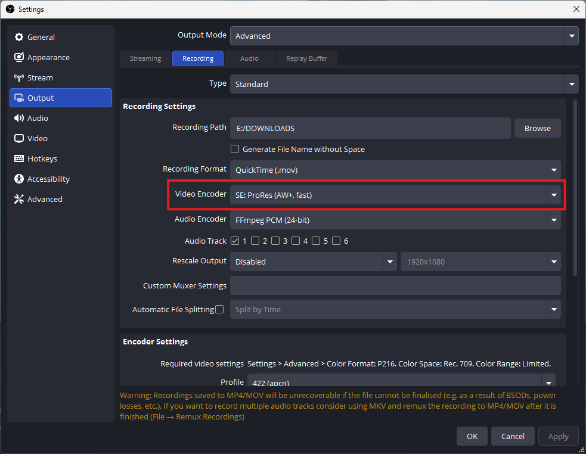

<!-- languages:start -->

<b>🌐 Language · Idioma · Langue · Sprache · Язык · 语言 · 言語 · 언어 · भाषा · لغة</b>

 

<table>
  <tr>
    <td align="center"><a href="../../README.md">English</a></td>
    <td align="center"><a href="README.ar.md">العربية</a></td>
    <td align="center"><a href="README.bn.md">বাংলা</a></td>
    <td align="center"><b>简体中文</b></td>
    <td align="center"><a href="README.fil.md">Filipino</a></td>
  </tr>
  <tr>
    <td align="center"><a href="README.fr.md">Français</a></td>
    <td align="center"><a href="README.de.md">Deutsch</a></td>
    <td align="center"><a href="README.hi.md">हिन्दी</a></td>
    <td align="center"><a href="README.id.md">Bahasa Indonesia</a></td>
    <td align="center"><a href="README.it.md">Italiano</a></td>
  </tr>
  <tr>
    <td align="center"><a href="README.ja.md">日本語</a></td>
    <td align="center"><a href="README.ko.md">한국어</a></td>
    <td align="center"><a href="README.fa.md">فارسی</a></td>
    <td align="center"><a href="README.pt-BR.md">Português (Brasil)</a></td>
    <td align="center"><a href="README.ru.md">Русский</a></td>
  </tr>
  <tr>
    <td align="center"><a href="README.es.md">Español</a></td>
    <td align="center"><a href="README.te.md">తెలుగు</a></td>
    <td align="center"><a href="README.th.md">ไทย</a></td>
    <td align="center"><a href="README.tr.md">Türkçe</a></td>
    <td align="center"><a href="README.vi.md">Tiếng Việt</a></td>
  </tr>
</table>

<!-- languages:end -->

# StudioEncoder：适合剪辑的 OBS Studio 编码器

> 本译文由 AI 撰写，未经母语人士审校。OBS Studio 中的菜单、设置和编码器名称保留英文，与 OBS 的显示一致。以[英文 README](../../README.md)为准。

这是一个适用于 Windows 的 OBS Studio 插件，为 OBS Studio 33 及更高版本添加全帧内（all-intra）10 位编码器，用于录制便于剪辑的 4K MOV。

- **AW+** 是兼容 ProRes 的 CPU 编码器，支持 10 位 4:2:2 色彩。它是 FFmpeg 的 ProRes 编码器（`prores_aw`）的改进版，修复了一个会让 ProRes Proxy 模式下的画面发糊的舍入错误。它还针对速度做了优化，所用 CPU 大约只有 FFmpeg 编码器的一半。
- **支持 10 位 4:2:2 的 GPU 编码器：** 面向 NVIDIA RTX 50 系列显卡的 H.264，以及通过 Intel QuickSync 的 HEVC（在 Intel Panther Lake CPU 上测试）。
- **支持 10 位 4:2:0 的 GPU 编码器：** 面向 AMD GPU 和比 RTX 50 系列更早的 NVIDIA 显卡的全帧内 HEVC。OBS 已经为这些 GPU 提供了硬件 HEVC 编码器，但 StudioEncoder 用简单的预设取代晦涩的设置，让它们更易用。AMD GPU 无法编码 4:2:2，因此这些仍为 4:2:0。

自 OBS 33.0 起，Custom Output (FFmpeg) 路径存在一个错误，偶尔会引发“non monotonically increasing dts”错误，并可能导致新的录制无法开始。StudioEncoder 避开了这条路径：它的编码器在 **Standard** 录制模式下运行，因此运行顺畅。

> **不是 Apple ProRes。** 本插件为非官方产品，与 Apple 无关联，也未获 Apple 认可。Apple ProRes 是受许可、经认证的编解码器。这里的编码器是对公开文档格式（SMPTE RDD 36）的独立实现：FFmpeg 的 `prores_aw`（以及基于它构建的 AW+ 编码器）、FilmCraft Rust 编码器和 OxideAV Rust 编码器。它们的输出可以在 DaVinci Resolve 等常见剪辑软件中播放，但未经 Apple 认证。

## 硬件

采集卡决定你是否真的在录制 10 位 4:2:2，因为它必须把 10 位 4:2:2 送到电脑。

**采集卡。** 在电脑上采集 4K 10 位 4:2:2，最便宜的方式是 Blackmagic Design Intensity 或 DeckLink 卡，或 Magewell Pro Capture 卡。AJA 和 Datapath 的卡也能做到，但价格高得多。

**OBS 中的 P210。** OBS 自带的 Video Capture Device 源无法采集 P210 像素格式（10 位 4:2:2），它最高只到 10 位 4:2:0。Blackmagic 卡（v210）已经可以通过 DeckLink 源在 OBS 中使用。StudioEncoder 增加了对 Magewell 卡和其他任何输出 P210 的卡的支持，这是 OBS 从未有过的。请使用 **SE: 10-bit 4:2:2 capture (P210)** 源。

**PCIe 卡。** 卡需要接到 **x4 通道**的插槽才能全速运行。不要让它与 M.2 插座或 SATA 接口共用通道，否则可能把插槽降到 x2 或 x1。请查看主板手册。

**USB 卡。** 4K30 10 位 4:2:2 打包为 v210 时约需 5.3 Gbit/s，以 P210 传输则需 8.0 Gbit/s。5 Gbit/s 的 USB 3.0 链路实际只能传约 3.5 到 4 Gbit/s，因此做不到。你需要真正的 10 Gbit/s USB 3.2 Gen 2 接口、合适的线缆和输出 10 位 4:2:2 的卡，而 4K30 P210 也只是勉强放得下。4K60 在任何 USB 链路上都放不下。大多数 USB 采集卡只提供 8 位 4:2:2 或 10 位 4:2:0，所以购买前请先查看卡的输出格式。

## 编码器

| OBS 中的编码器 | 实现 | 说明 |
|---|---|---|
| SE: ProRes (AW+, fast) | AW+：内置于插件的 FFmpeg `prores_aw`，已修正舍入 | **推荐。** 对 CPU 友好：在支持 AVX2 的 CPU 上，它的占用约为 FFmpeg 自带 prores_aw 的一半；在较旧或低端 CPU 上回退到纯 C（仍比 FFmpeg 快）。Proxy 保留细节；FFmpeg 的 prores_aw 会让 Proxy 发糊。 |
| ProRes-compatible (Rust / FilmCraft) (experimental) | [FilmCraft](https://github.com/storytold/filmcraft) Rust 编码器 | 实验性。4K 下 CPU 占用很高。 |
| ProRes (OxideAV, pure Rust) (experimental) | [OxideAV](https://github.com/oxideav/oxideav) `oxideav-prores` | 实验性。4K 下 CPU 占用约为 prores_aw 的 2.5 倍（22 线程笔记本上 30% 对 12%），在实拍素材的 422 档位上文件大约大三分之一，每比特质量没有优势。代码非常年轻（0.1）。 |
| H.264 10-bit 4:2:2 Intra (NVIDIA NVENC, RTX 50 series) | FFmpeg `h264_nvenc` | 在 GPU 上生成更小的文件。需要 **RTX 50 系列**显卡。见下文。 |
| HEVC 10-bit 4:2:0 Intra (NVIDIA NVENC) | FFmpeg `hevc_nvenc` | 适用于**比 RTX 50 系列更早**的 NVIDIA 显卡（它们没有 10 位 H.264）：10 位 **4:2:0**，每帧都是关键帧，有码率设置。见下文。 |
| HEVC 10-bit Intra (AMD) | FFmpeg `hevc_amf` | 在 Radeon GPU 上的 10 位 **4:2:0**，每帧都是关键帧，有四个质量预设。见下文。 |

档位：Proxy（`apco`）、LT（`apcs`）、422（`apcn`）、HQ（`apch`）。

### 选择显示哪些编码器（Tools > StudioEncoder）

OBS 的编码器列表默认保持简短。**Tools > StudioEncoder** 会打开一个窗口，分三部分列出本插件的所有编码器：**Recommended (10-bit 4:2:2)**（AW+ 和 RTX 50 的 H.264 编码器）、**10-bit 4:2:0**（NVIDIA 和 AMD 的 HEVC 编码器）以及 **Experimental**（FilmCraft 和 OxideAV，默认关闭）。后两部分是可折叠的分组，初始为收起状态；点击小箭头即可展开。勾选你想要的，然后按 OK；重启 OBS 后生效。

 StudioEncoder）：带复选框的编码器列表，以及可折叠的 10-bit 4:2:0 和 Experimental 分组" width="420">

关闭的编码器只是从下拉列表中隐藏。已经使用它的配置仍然可用。本插件的所有编码器在 OBS 的编码器列表中都以“SE:”开头，便于辨认。

### 为什么选 AW+（修复后的 prores_aw）

FFmpeg 的 prores_aw 把每个细节系数除以其量化步长并**向零截断**，所以小于一个完整步长的部分都会被丢掉。在 Proxy 下步长较粗，这会去掉细腻的纹理：人脸和织物看起来发糊。Apple 的编码器使用同样的 Proxy 矩阵和量化器，却保留了这些细节。AW+ 是移植进插件的 prores_aw，用舍入代替截断（各档位的偏移：Proxy 4/8、LT 3/8、422 3/8、HQ 2/8 个步长，按每比特最佳质量选取）。

在一段 4K 摄像机素材上的测量结果（PSNR，越高越好）：

| 档位 | FFmpeg prores_aw | AW+ | Apple ProRes |
|---|---|---|---|
| Proxy | 74 Mbit/s，54.0 dB | **94 Mbit/s，56.2 dB** | 96 Mbit/s，56.5 dB |
| LT | 170 Mbit/s，59.7 dB | 198 Mbit/s，61.6 dB | 235 Mbit/s，62.2 dB |
| HQ | 492 Mbit/s，71.1 dB | 560 Mbit/s，73.5 dB | 520 Mbit/s，72.2 dB |

关闭舍入后，AW+ 生成的文件与 FFmpeg 的 prores_aw 逐字节相同（已在四个档位上验证）。
GPU 编码器会在 OBS 启动时检查你的显卡。如果显卡无法运行其中某个编码器（H.264 编码器需要 RTX 50 系列，比它更早的 NVIDIA 显卡不行；NVIDIA HEVC 编码器需要支持 10 位 HEVC 的 NVIDIA 显卡；AMD 编码器需要 Radeon），该编码器会从列表中隐藏，并在此窗口中显示为灰色。

### H.264 10-bit 4:2:2 Intra (NVIDIA NVENC)

在 GPU 上编码的节省空间的 ProRes 替代方案。每帧都是关键帧（all-intra），High 4:2:2 档，10 位，恒定码率，所以剪辑起来像 ProRes，但文件更小，代价是画质略有下降。

- **需要 NVIDIA RTX 50 系列 GPU**（Blackwell）和较新的驱动。更旧的 NVIDIA 显卡无法编码 10 位 H.264 或 4:2:2；在它们上录制不会开始，OBS 会显示错误。请改用 ProRes（prores_aw）。
- **Bitrate**：100 Mbit/s（小，画质约相当于 ProRes LT），**200（默认**，优于 ProRes LT，大小约为 ProRes 422 的一半），300（高）。超过 400 没有额外好处。
- **Speed**：Quality（p5，默认）或 Fast（p1，画质略低）。
- 帧以 P216 送入 GPU，无需转换。同时处理的帧最多 2 个，因为消费级 NVIDIA 显卡限制编码器会话数。
- 在 RTX 5080 上做的 FFmpeg 测试（4K 29.97 摄像机素材）中，p5 约 77 fps，p1 约 101 fps。

### HEVC 10-bit 4:2:0 Intra (NVIDIA NVENC)

适用于**比 RTX 50 系列更早**的 NVIDIA 显卡（GTX 10 系列及更新的应该可用；在 RTX 4070 Laptop 上测试）。这些显卡没有 10 位 H.264 模式，也没有 4:2:2，所以这是 **10 位 4:2:0** 的 HEVC（Main 10）：色彩细节只有 ProRes 422 所保留的一半，但每帧都是关键帧，因此可以像 ProRes 一样剪切和拖动，文件更小。在 RTX 50 显卡上，你还可以使用上面能保留色彩细节的 H.264 4:2:2 编码器。

- **Settings > Advanced > Color Format: P010**（不是 P216），Rec. 709，Limited。画面按 OBS 生成的样子送入 GPU，无需转换。
- **Bitrate**（30 到 400 Mbit/s，默认 150）和 **Speed**（Quality p5 或 Fast p1）。在一段 4K 摄像机素材上的测试（亮度质量，对照源文件）：100 Mbit/s 测得 57.6 dB，优于 ProRes Proxy（95 Mbit/s 时 53.7 dB）；150 测得 59.4 dB，约等于 AW+ LT（200 Mbit/s 时 59.6 dB），只用其 70% 的比特；200 测得 60.8 dB。Fast 预设的质量只略低，在该 GPU 上速度也差不多。
- 录制文件是带 `hvc1` 标签的 MOV 中的 HEVC Main 10（所有帧都是关键帧，在 FFmpeg 中解码无错误）。尚未在 Resolve 或 Premiere 中试过。
- 同时最多编码 2 帧，因为消费级 NVIDIA 显卡限制编码器会话数。在 RTX 4070 Laptop 上每个 4K 帧约 15 ms；OBS 用了约 7% 的 CPU（其中约 5% 来自场景本身）。

### HEVC 10-bit 4:2:0 Intra (AMD)

面向 Radeon 用户。AMD 的视频编码器完全无法做 4:2:2（其 H.264 编码器也不能做 10 位），所以这是 **10 位 4:2:0**：色彩细节只有 ProRes 422 所保留的一半。每帧都是关键帧，所以像 ProRes 一样，每一帧都可以不解码相邻帧就剪切和拖动，文件小得多（在测试素材上，High 约为 ProRes 422 的三分之一）。OBS 自带的“AMD HW H.265 (HEVC)”也能录制 10 位，但需要常规的 GOP 和码率调校；本编码器用一个 **Quality** 选项取代了这些。

- **Settings > Advanced > Color Format: P010**（不是 P216），Rec. 709，Limited。
- **Quality** 是恒定的，所以文件大小取决于画面。4K 29.97 摄像机素材的典型大小：

| 预设 | 大小 | 4K 摄像机素材的亮度 PSNR |
|---|---|---|
| Small | 约 30 Mbit/s | 52.4 dB |
| Standard | 约 70 Mbit/s | 55.3 dB（ProRes LT：169 Mbit/s 时 56.2 dB） |
| **High**（默认） | 约 120 Mbit/s | 56.7 dB |
| Maximum | 约 170 Mbit/s | 57.8 dB（编码器的上限） |

  PSNR 数值是与转换成 4:2:0 的摄像机素材比较的，因此对本编码器是公平的；ProRes 保留了本编码器做不到的 4:2:2 色彩。噪点多的素材在同一预设下文件更大。
- 在 Radeon RX 9070 XT 上测得：每个 4K 帧约 3.8 ms，4K 29.97 下没有重复帧。AMD 编码器返回每个数据包都晚一帧，所以按下 Stop 之前的最后一帧会被丢弃。
- 录制文件是 MOV 中的 HEVC Main 10（所有帧都是关键帧，时间戳稳定，在 FFmpeg 中解码无错误）。尚未在 Resolve 或 Premiere 中试过。

## 10 位 4:2:2 采集（P210），Windows

OBS 自带的 Video Capture Device 源无法导入 10 位 4:2:2：它的 DirectShow 采集止步于 P010（10 位 4:2:0）。一些采集卡，比如 Magewell Pro Capture，以 P210 提供 10 位 4:2:2。StudioEncoder 为它们增加了一个源：**Sources > + > SE: 10-bit 4:2:2 capture (P210)**。

- 在 Device 下选择卡，或保持“First device that offers P210”。
- 把 Resolution 和 Frame rate 设成与摄像机的 HDMI 信号一致（默认 3840x2160，29.97）。
- 把 **Settings > Video > Advanced > Color Format 设为 P216**，这样 10 位才能到达编码器。使用 P216 时，OBS 以 16 位浮点混合场景。
- 用单独的 Audio Input Capture 源添加卡的音频。

帧会为 OBS 从 P210 转换成 I210：无损的移位和平面拆分，在 Ryzen 9 9950X3D 上每个 4K 帧约 2.4 ms。已用 Magewell Pro Capture HDMI 4K 在 3840x2160 29.97 下测试：没有重复帧，样本带有真正的 10 位数值。`tools/p210-probe.cpp` 是一个小型命令行程序，用来检查某张卡的 P210 输出是否含有真正的 10 位数据。

## 系统要求

- Windows 10/11 x64
- OBS Studio 33.0.x（基于 33.0.0 构建；在 33.0.1 上测试）

## 安装

关闭 OBS，然后从发布的 zip 中复制 `obs-studioencoder` 文件夹：

- **已安装的 OBS：** 复制到 `C:\ProgramData\obs-studio\plugins\obs-studioencoder\`。`ProgramData` 是隐藏的；请在文件资源管理器中输入路径。
- **便携版 OBS：** 复制到 `<OBS folder>\plugins\obs-studioencoder\`，与 `bin`、`data` 和 `config` 并列。

该文件夹必须包含 `obs-studioencoder.dll` 和 `data\locale\`。在 OBS 中，Tools → Plugin Manager 应列出“StudioEncoder”，Tools → StudioEncoder 会打开它的设置。

不要使用旧的 `obs-plugins\64bit` 或 `data\obs-plugins` 文件夹。OBS 33 把这些位置标记为旧版。

## 设置

1. Settings → Advanced：**Color Format P216**（两个 HEVC 编码器用 **P010**），Color Space Rec. 709，Color Range Limited。

   

2. Settings → Video：把画布（Base）和输出分辨率（Output）设为你的录制尺寸，帧率与你的源一致。截图显示的是 29.97 下的 3840x2160。

   

3. Settings → Output：Output Mode **Advanced**，Recording 选项卡，Type **Standard**，Recording Format **MOV**。
4. Video Encoder：上面的某个编码器（以“SE:”开头）。Encoder Settings 下方的“Required video settings”一行会重复该编码器所需的 Color Format、Color Space 和 Color Range。

   

   在它的设置中：
   - **Profile**（ProRes 编码器）：Proxy、LT、422 或 HQ。**Bitrate** 和 **Speed**（NVENC 编码器）：见上文。
   - **Frames in flight**：0（自动，推荐）。按需并行编码帧，每个 CPU 核心一帧。
   - **Automatic sizing**（仅在 Frames in flight 为 0 时）：*Grow when frames are late*（默认）或 *Size from measured frame cost*（实验性）。第二种从 4 个 worker 开始，给一帧计时，然后一次性设定所需的 worker 数。这样对轻量编码器占用内存更少，对重型编码器则更快升到位。两种方式的 CPU 负载相同。
   - **On overload**：*Warn in the log* 或 *Stop recording*。
   - **Log verbosity**：Info 会显示计时和自动调整信息。

## 过载

如果编码器跟不上，OBS 会重复上一帧以保持时间线，录制在这些位置看起来像是卡住了。插件会按每次录制统计这些重复帧（当 OBS 连续两次给它同一帧时它会察觉）：
- 每当发生这种情况的一秒，它都会向日志写入一条 `OVERLOAD` 警告，并在录制结束时写入一份汇总。
- 使用 **On overload: Stop recording** 时，它会在连续 3 秒过载后结束录制并显示错误。

如果你看到过载警告，请改用 prores_aw 编码器或更轻量的档位。

## 已知限制

- 输入必须是 P216（HEVC 编码器用 P010）。OBS 33 没有提供其他 10 位 4:2:2 输出格式。
- 按下 Stop 之后才采集、但仍在编码的帧会被丢弃。这是预期行为；录制在停止点结束。
- 尚未测试混合 MOV。
- Windows。Linux 可以构建并运行（在 Ubuntu 和 CachyOS 上测试；见 `docs/HANDOFF.md`，“Build and test on Linux”和“Linux results”）。

## 构建

构建说明（工具链和步骤）仅见[英文 README](../../README.md#build)。

## 许可证

GPL-2.0-or-later（见 `LICENSE`），这是 OBS 插件的要求。第三方代码：
- FFmpeg（LGPL），与 OBS 一同分发。
- FilmCraft ProRes crate（MIT OR Apache-2.0，按 MIT 使用）。
- AW+（`src/prores-aw.c`）：FFmpeg 的 prores_aw 编码器、正向 DCT 和 ProRes 表的移植（LGPL 2.1 或更高版本；Anatoliy Wasserman、Konstantin Shishkov、Independent JPEG Group），按 GPL 使用。
- `oxideav-prores` 和 `oxideav-core`（MIT），OxideAV ProRes 编码器。
